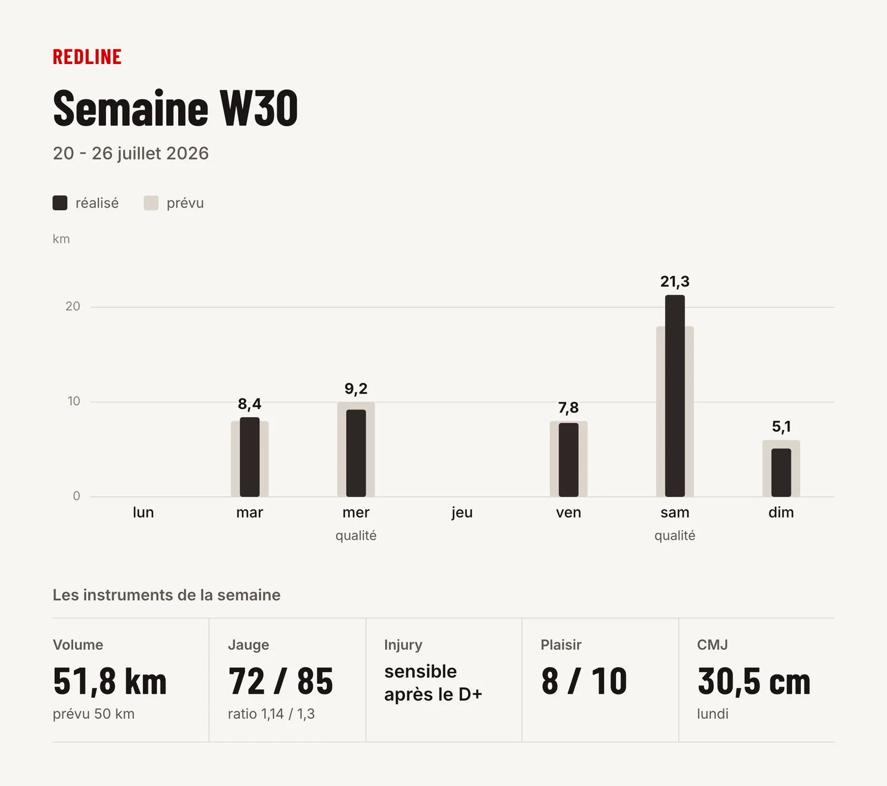
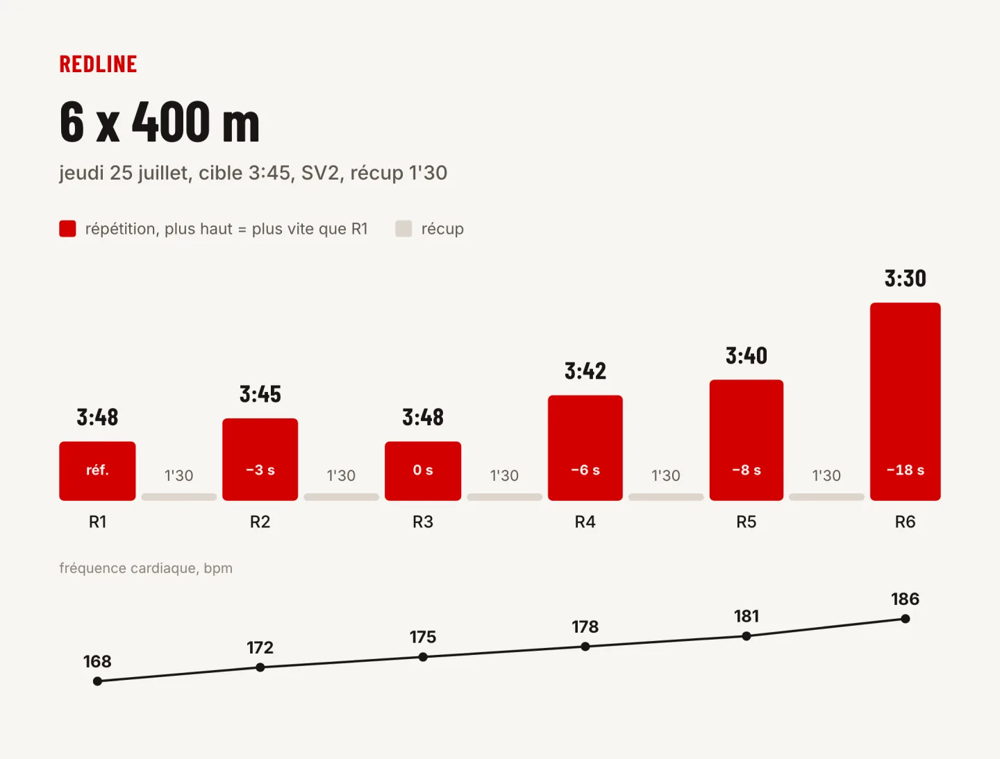
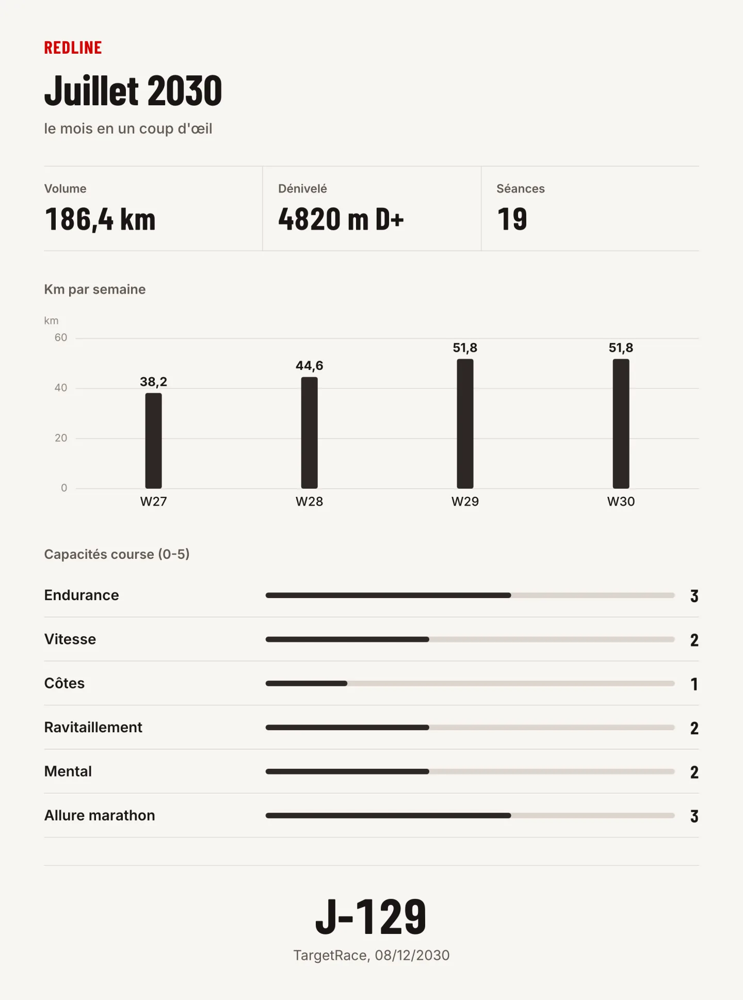

# Redline — a self-hosted AI running coach

[](https://github.com/Maxbrt18/redline/actions/workflows/code-checks.yml)
[](LICENSE)

Redline is a running coach that lives in Facebook Messenger. It reads your Strava
activities, keeps an append-only training ledger in PostgreSQL, maintains a revisioned
weekly plan, debriefs every run, and answers through an LLM agent that is **forced to read
the facts before it speaks**.

> **This is the open-source edition.** It is the engine of a personal coach I built and use
> daily, stripped of everything personal: no athlete data, no Strava data, no keys, no
> private knowledge vault. What remains is the code, the schema, the templates and the
> design ideas. It is published as-is: **no support, no roadmap, no guarantees.**
>
> The coach speaks **French**: prompts, messages and most comments are in French.
> The code is organised so that it can be translated, but that work is not done.
>
> The engine never names the athlete: the name, the heart rates behind the training
> zones, the watched injuries and the tracked capabilities come from `redline.toml` (see `redline.example.toml`). The coaching rules,
> their thresholds and the kinds of transition session come from the vault's
> `rulebook.toml`, or from the engine's `rulebook.default.toml` when the vault has none.
> `Sam` is the fictional athlete of the test suite only.
>
> Redline is an AI, not a medical professional. It gives no diagnosis and no medication
> advice, and says so.

## Ideas worth stealing

- **One owner per fact.** Sessions and pain readings live in an append-only ledger; the
  weekly programme is a revisioned object; nothing is copied into prose.
- **A reading ladder (N0–N3).** The agent reads more as the question gets more
  consequential, and must escalate before asserting anything it has not read this session.
- **Numbers are computed, never recalled.** Volume, climb and load come from a ledger CLI,
  not from the model's memory.
- **Falsifiable decisions.** Each coaching decision carries a prediction with a date and a
  failure criterion; a monthly ritual argues against active decisions.
- **A calibration rule.** When the athlete corrects the coach, the correction is logged
  with what should have been read, and replayed as a regression scenario.

## What is in the box

| Path | What it is |
|---|---|
| `src/redline/service/` | The service: Messenger and Strava webhooks, proactive messages, agent runtime, mobile "notebook" web app (PWA) |
| `src/redline/cli/` | The commands the agent calls (`ledger.py`, `week-plan.py`, `strava.py`, `fact-write.py`…), one module each |
| `src/redline/model/`, `analysis/`, `integrations/`, `coach/` | The typed domain, the ledger and its reports, Strava and the weather, the coach's words |
| `src/redline/storage/`, `migrations/` | PostgreSQL schema (Alembic) and repository layer |
| `src/redline/cards/` | HTML/PNG card renderer (week, month, workout, strength) |
| `deploy/` | systemd units, Caddy, PostgreSQL (Compose, backups), the agent's command launcher and its allowlist, the runtime updater |
| `templates/` | Note templates for a vault (athlete onboarding, weekly review, debrief…) |
| `templates/vault/CLAUDE.md` | A **template** of the coach's instruction file, copied into a vault: reading ladder, calibration rule, fact-ownership table |
| `docs/storage-architecture.md` | Why PostgreSQL owns operational facts and Git owns knowledge |
| `tests/` | 1,982 tests (engine, storage, web app, prompts), run against a fictional vault; 159 skip without PostgreSQL |

## The cards

Some answers are images instead of prose: the weekly recap, the month view, the workout
debrief and the strength session arrive as cards typeset by the browser renderer in
`src/redline/cards/`, from the numbers the ledger already owns. The three below are rendered
from the committed samples (`src/redline/cards/samples/*.json`; the race name is a
placeholder):

```bash
python -m redline.cli.chart_week -o /tmp/week.png < src/redline/cards/samples/week.json
```

<p>
  
  
</p>
<p>
  
</p>

## What is NOT included

The knowledge vault of the original deployment (athlete profile, journal, decisions,
corrections, research notes, strength programme) is private and deliberately absent. Bring
your own: the scripts expect a vault laid out as described in `templates/vault/CLAUDE.md`. The test suite
ships a small fictional one, Sam's, in `tests/fixtures/vault/`: the tests run on a
temporary copy of it through `VAULT_PATH`, exactly as the service runs on yours.

## Running it

See [`docs/deployment.md`](docs/deployment.md) for the full deployment: PostgreSQL via
Docker Compose, Alembic migrations, environment variables (`deploy/coach-messenger.env.example`), systemd
units, Caddy. You need your own Strava API application, a Messenger app, and an LLM agent
runtime.

```bash
python3.12 -m venv .venv && . .venv/bin/activate
pip install -r requirements.txt -r requirements-dev.txt
pip install --no-deps -e .   # the engine, as the `redline` package
playwright install chromium   # the page and card tests drive a real browser
pytest -q
```

Every skip carries its reason: 159 need PostgreSQL (`TEST_DATABASE_URL`), and the browser
tests need `playwright install chromium`.

To commit changes, run `git config core.hooksPath .githooks` first: it enables the
pre-commit hook that regenerates the generated views before every commit.

## Contributing and security

Conventions for changing the engine (people and coding agents): [`AGENTS.md`](AGENTS.md).
Reporting a vulnerability: [`SECURITY.md`](SECURITY.md). What the model provider
receives: [`docs/llm-data.md`](docs/llm-data.md).

## En bref (FR)

Redline est un coach de course à pied auto-hébergé : il lit Strava, tient un registre
d'entraînement en PostgreSQL, révise un plan hebdomadaire et répond via un agent LLM obligé
de lire les faits avant de parler. Cette version open source ne contient **aucune donnée
personnelle** : seulement le moteur, le schéma, les gabarits et les idées de conception.
Publié tel quel, sans support.

## License

GNU Affero General Public License v3.0 or later. If you run a modified version as a network
service, you must offer its source to the people who use it.
