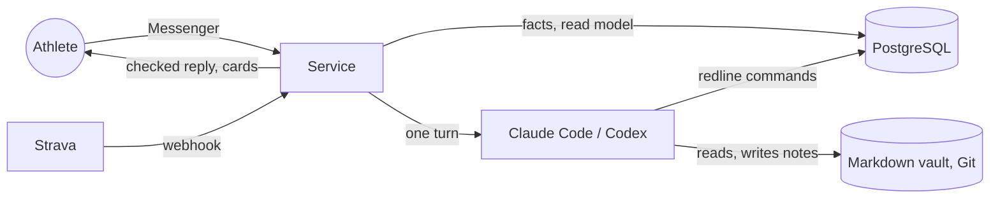

# Redline — a self-hosted AI running coach

[](https://github.com/Maxbrt18/redline/actions/workflows/code-checks.yml)
[](LICENSE)

Redline is a running coach that lives in Facebook Messenger. It reads your Strava
activities, keeps an append-only training ledger in PostgreSQL, maintains a revisioned
weekly plan, debriefs every run, and answers through an LLM agent (Claude Code or Codex)
that is **forced to read the facts before it speaks**.

> **Published as-is: no support, no roadmap, no guarantees.** This is the engine of a
> coach used daily, without anything personal: no athlete data, no keys, no private
> knowledge vault. The coach speaks **French**; the code and its documentation are in
> English. Redline is an AI, not a medical professional: it gives no diagnosis and no
> medication advice, and says so.

<p>
  
  
</p>

## How it works



The model writes prose and proposes changes; deterministic code owns everything else.
Every fact has one owner (PostgreSQL for what happened, the vault for why), the agent
reads more as a question gets more consequential (N0 to N3), numbers are computed by
CLIs rather than recalled, and a turn's writes are applied together or not at all.
[`docs/architecture.md`](docs/architecture.md) describes this harness.

## Try it

The cards render without anything else:

```bash
python3.12 -m venv .venv && . .venv/bin/activate
pip install -c requirements.txt -c requirements-dev.txt -e '.[cards,dev]'
playwright install chromium
redline chart-week -o /tmp/week.png < src/redline/cards/samples/week.json
```

To run the whole coach on a server you need a Meta app, a Strava API application, a
Claude (or OpenAI) account, a domain and a vault of your own. Start with
[`docs/getting-started.md`](docs/getting-started.md); then:

```bash
cp config/compose.env.example .env     # and fill it in, with redline.env and secrets/
docker compose up -d --build
```

## Documentation

| | |
|---|---|
| [Getting started](docs/getting-started.md) | The first time: the accounts, the vault, the configuration, the first message |
| [Self-hosting](docs/self-hosting.md) | Docker Compose or systemd, backups, updates, diagnostics |
| [Architecture](docs/architecture.md) | The harness: the turn, the owners of facts, the reading ladder, routing, delivery |
| [Vault format](docs/vault-format.md) | The files and frontmatter the engine reads in a vault |
| [Configuration](docs/configuration.md) | Every environment variable and configuration file |
| [What the model receives](docs/llm-data.md) | The data sent to the model provider |
| [Contributing](AGENTS.md) · [Security](SECURITY.md) · [Changes](CHANGELOG.md) | |

## Development

```bash
pytest -q -rs     # tests needing PostgreSQL or Chromium say why they skip
git config core.hooksPath .githooks
```

The suite runs against a fictional athlete, Sam, whose vault is in
`tests/fixtures/vault/`. PostgreSQL tests need `TEST_DATABASE_URL`; see
[`AGENTS.md`](AGENTS.md).

## License

GNU Affero General Public License v3.0 or later. If you run a modified version as a network
service, you must offer its source to the people who use it.
