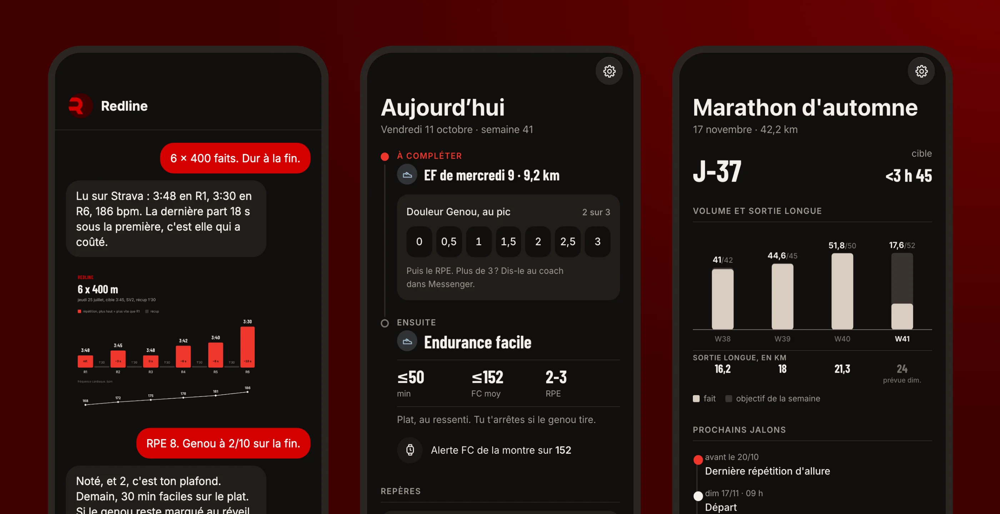
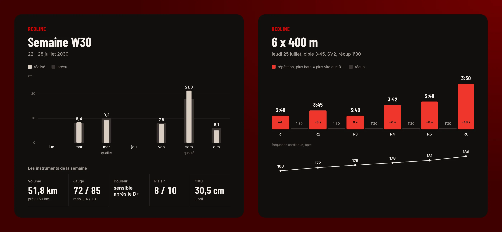

<p align="center">
  
</p>

<h1 align="center">Redline</h1>

<p align="center">
  <strong>An AI running coach you host yourself.</strong><br>
  It lives in Messenger, reads every run on Strava and adapts your week to what really happened.
</p>

<p align="center">
  <a href="https://github.com/Maxbrt18/redline/actions/workflows/code-checks.yml"></a>
  <a href="LICENSE"></a>
  <a href="docs/getting-started.md"></a>
</p>

<p align="center">
  <a href="#get-started"><strong>Get started</strong></a> ·
  <a href="docs/architecture.md">How it is built</a> ·
  <a href="docs/getting-started.md">Documentation</a>
</p>

Most AI coaches answer from memory, and a language model's memory is confident and
often wrong. Redline turns that around: **your history lives in a database, the numbers
are computed by code, and the model has to read them before it speaks.**

<p align="center">
  
</p>
<p align="center"><sub>Sam is the fictional athlete of the test suite, and this conversation is an illustration. The coach speaks French.</sub></p>

## What your coach does

| | |
|---|---|
| **Debriefs every run** | A Strava activity arrives, and the coach reads your splits, heart rate and weather, then asks what the watch cannot know. |
| **Keeps your week honest** | The plan is revisioned, never overwritten. A session you missed or a sore knee changes it, under rules you can read. |
| **Watches what hurts** | Pain is tracked by zone, during the effort and on waking, and a limit you set is a limit it holds. |
| **Lives on your phone** | Messenger for the conversation, and a private web app for today's session, your week and your race. |
| **Sends real charts** | Weekly, monthly and workout cards, rendered from the ledger rather than described by a model. |

<p align="center">
  
</p>

## Why you can trust the numbers

The model reasons and writes; deterministic code owns everything else. It decides what
to say, and the code decides what is true and what gets recorded.

<p align="center">
  
</p>

- **One owner per fact.** PostgreSQL holds what happened; a Markdown vault in Git holds why.
- **Nothing is recalled.** Volume, load and pain come from commands, never from memory.
- **All or nothing.** A turn's writes apply together, or not at all.
- **The method is yours.** Your rules, notes and thresholds live in your vault, not in the engine.

[`docs/architecture.md`](docs/architecture.md) describes the whole harness.

## Get started

Try the cards in a minute, with nothing else to set up:

```bash
python3.12 -m venv .venv && . .venv/bin/activate
pip install -c requirements.txt -c requirements-dev.txt -e '.[cards,dev]'
playwright install chromium
redline chart-week -o /tmp/week.png < src/redline/cards/samples/week.json
```

To run the whole coach you need a server, a domain, a Meta app, a Strava API application,
a Claude (or OpenAI) account and a vault of your own.
[`docs/getting-started.md`](docs/getting-started.md) walks through all of it; then:

```bash
cp config/compose.env.example .env     # and fill it in, with redline.env and secrets/
docker compose up -d --build
```

## Documentation

| | |
|---|---|
| [Getting started](docs/getting-started.md) | The accounts, the vault, the configuration, the first message |
| [Self-hosting](docs/self-hosting.md) | Docker Compose or systemd, backups, updates, diagnostics |
| [Architecture](docs/architecture.md) | The turn, the owners of facts, the reading ladder, routing, delivery |
| [Vault format](docs/vault-format.md) | The files and frontmatter the engine reads in a vault |
| [Configuration](docs/configuration.md) | Every environment variable and configuration file |
| [What the model receives](docs/llm-data.md) | The data sent to the model provider |

## Good to know

- **Published as is.** This is the engine of a coach used daily, without anything personal:
  no athlete data, no keys, no private knowledge vault. There is no support: it moves with
  the needs of the runner who uses it, and each release is listed in the
  [changelog](CHANGELOG.md).
- **The coach speaks French.** The code and its documentation are in English.
- **It is an AI, not a medical professional.** It gives no diagnosis and no medication
  advice, and says so.

[Contributing](CONTRIBUTING.md) · [Code of conduct](CODE_OF_CONDUCT.md) · [Security](SECURITY.md) · [Changes](CHANGELOG.md)

## License

GNU Affero General Public License v3.0 or later. If you run a modified version as a network
service, you must offer its source to the people who use it.
