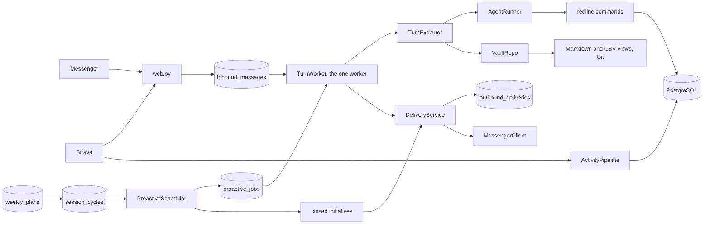

# Architecture: the harness around the model

Redline is a harness: a deterministic service around a language model. The model reads,
reasons, writes prose and proposes changes. The code authenticates, schedules, stores,
validates and delivers. A reply that the model got wrong can be corrected; a fact that
the code lost or invented cannot. So the line between the two is drawn on purpose:

| The model decides | The code decides |
|---|---|
| what to say, in what tone | who may talk to the coach, and when it may speak first |
| what to read before answering | what it is given to read, and how much (the reading level) |
| which facts to record, which plan to propose | whether those facts and that plan are valid, and applied together |
| | what is sent: the reply, the canonical plan, the cards, the follow-ups |

Coaching policy itself (the method, the tone, the rules) does not live in the engine.
It lives in the vault: its `CLAUDE.md`, its notes, and its `rulebook.toml`, the rules
in force and their thresholds. The engine applies the rulebook; it does not write it.

## The pieces

Webhooks answer quickly and store what they receive. A single worker then serializes
messages, commands and initiatives, so two turns never share an agent session, a
working tree or a delivery.

## One owner per fact

Each fact has one owner, and nothing copies it:

- **PostgreSQL owns what happened and what is planned**: sessions and pain readings
  (an append-only ledger), the daily state, the weekly plan (append-only revisions),
  capabilities, threads, deadlines, predictions, deliveries, the agent's sessions.
- **The vault owns the reasons**: the athlete's profile, the goals, the decisions and
  their predictions in prose, the corrections, the method, the knowledge base. It is a
  Git repository of Markdown notes, readable in Obsidian.
- **Derived state is computed, never stored**: today's form, the pain trend, the
  week's load. A summary the coach rereads first (`ai/hot-cache.md`) is regenerated,
  not maintained.

The Markdown and CSV files that show PostgreSQL facts in the vault are projections:
regenerated after each change, never edited. A turn that edits one sees it restored.

### Storage

PostgreSQL 17 is mandatory: the service refuses to start without `DATABASE_URL`, and
there is no fallback to files. Its schema, `redline`, follows a few rules:

- tables in the plural, `snake_case`; a UUID `id`; natural keys `*_key`, foreign keys
  `*_id`, civil dates `*_on`, UTC instants `*_at`;
- one column per sports metric, each with an explicit state: `pending`, `known`,
  `unavailable` or `not_applicable`. A `known` value is bounded and immutable (trigger);
- `JSONB` only for validated envelopes whose fields are never queried across rows:
  the commands of a turn, the audit, the Strava distillate, a session's nested
  prescription;
- the closed vocabularies (sleep, life load, statuses…) are English slugs declared once
  in `src/redline/model/vocabulary.py`, which the CHECK constraints are built from;
- plans are append-only, with contiguous revisions; every change to a future session
  names the fields it touches and the typed evidence and rule behind it;
- an idempotency key reused with different content is an error, never a silent success.

Three roles split the rights: `redline_owner` (no login) owns the schema,
`redline_migrator` takes that role for Alembic, `redline_app` reads and writes the
business tables and nothing else. The audit log is append-only.
`deploy/postgres/init-roles.sh` creates them. The schema is in
`src/redline/storage/schema.py`, its history in `migrations/`.

## A turn

An agent turn is one model call, wrapped in a transaction:

1. `web.py` checks the Meta signature and the allowed sender, and stores the message
   (`inbound_messages`, `pending`).
2. `TurnWorker` groups messages sent close together and **triages** them: a few exact
   greetings locally, anything else by a small model that answers a JSON schema. The
   result is a reading level, N0 to N3, plus flags (emotion, plan change, plan
   requested). A failed or late triage counts as N1.
3. The service injects what that level needs: today's date, a bounded packet of
   PostgreSQL facts, the active plan when the turn may prescribe, the rulebook, the open
   questions.
4. `TurnExecutor` gives the turn a `turn_id` and runs the agent. Every command the agent
   runs carries `REDLINE_TURN_ID`: its writes are **staged** in `turn_commands`, not
   applied.
5. After the call, all the staged commands are applied in **one PostgreSQL
   transaction**, retried three times on a transient failure. An invalid command
   cancels the batch. A projection or capability note edited during the turn is
   restored file by file, without losing the other notes or the commands.
6. The weeks the reply depends on are reread and validated. The vault notes are
   committed locally, without network.
7. `TurnWorker` decides whether the canonical plan goes with the prose.
8. `DeliveryService` stores the full envelope (text, buttons) in
   `outbound_deliveries`, then sends it. A retry resends this envelope, never a new turn.
9. The message moves to `done`. A crash before this point makes it recoverable at the
   next start.
10. After delivery only, the worker regenerates the views, commits and pushes the vault.

An agent error or a refused persistence drops the staged commands and restores the
working tree. Facts already committed are never presented as rolled back because a
projection or a push failed afterwards. If persistence is refused, the prose is still
sent, with a line naming what was not recorded, and no plan goes with it.

`redline week-plan preview` runs the same transaction inside a savepoint that it rolls
back: the coach can explore a change without preparing it.

An attachment (photo, PDF) has its own boundary: the worker downloads a bounded file
into a private temporary folder, runs a **read-only** turn, then deletes the file. The
coach can only name candidate facts; a later message must confirm them.

## The reading ladder

The triage level decides how much the coach reads before answering, and which model
profile answers:

| Level | The athlete asks | The coach reads, in addition |
|---|---|---|
| N0 | social, logistics | nothing |
| N1 | routine: today's session, a debrief, the week | the context packet, the week's plan |
| N2 | a judgment that commits: an increase, a pain to settle, a moved session | the owner note of the subject, the protocols |
| N3 | out of the ordinary: a mechanism, a contradiction, "are you sure?" | the sources, the episode notes, the web |

The level sets what is read, not the length of the answer: a checked correction at N3
can fit in one sentence. The vault's `CLAUDE.md` holds the full ladder; the engine's
template is `templates/vault/CLAUDE.md`.

## Routing

`src/redline/service/routing.py` maps each route to a model, an effort, a timeout and a
session mode, for either provider:

| Route | Codex | Claude | Session |
|---|---|---|---|
| triage | GPT-6 Luna, low | Haiku 5.5, low | isolated, read-only, no fallback |
| N0 | Luna, medium | Sonnet, low | continued |
| N1 | Luna, high | Sonnet, low | continued |
| N2 | GPT-6 Sol, medium | Sonnet, high | continued |
| N3 | Sol, high | Opus, medium | continued |
| `/deep` | Sol, high | Opus, high | forked |
| heavy initiative | Sol, high | Opus, high | isolated |

Each route except triage has one fallback, used only for a failure before any useful
work (a quota, an unavailable model). Once a turn has started, a failure, `/cancel` or
the watchdog is final: no other model redoes the work. N0 to N2 share Sonnet on the
Claude side, so the continued session keeps its cache. The operator overrides any row
in a file named by `REDLINE_ROUTING` ([configuration](configuration.md)).

A session lasts `SESSION_TTL_HOURS` and stays tied to its provider and to the
fingerprint of its instructions (the style prompt, the vault's `CLAUDE.md`,
`AGENTS.md` and `redline.toml`). A change to any of them starts a new session at the
next turn; a commit of notes does not.

## What the agent may do

The agent works in the vault and runs only the commands listed in
`deploy/agent-cli/agent-cli-tools.txt`, through `redline-agent-cli`. The launcher refuses
a command outside the list, a call without a valid `REDLINE_TURN_ID`, an engine that
differs from its deployed commit, and an engine or venv the service account could
write. Claude Code runs with `--restricted --strict-mcp-config`: no settings file, hook
or MCP server written by a turn is ever loaded. Codex runs in its workspace sandbox,
writing only to the vault and `REDLINE_STATE_DIR`. [`SECURITY.md`](../SECURITY.md) lists
what this guarantees and what it does not.

## The plan

The weekly plan belongs to PostgreSQL. `redline week-plan` shows, checks and revises
it:

| `check` and `show` exit code | Meaning |
|---|---|
| 0 | prescribable |
| 1 | absent or invalid: nothing is prescribed |
| 2 | valid, but a dated check waits for an answer: the coach asks it |
| 3 | stale (an effort happened outside the plan): the coach answers but revises before prescribing |

The plan carries the intention (`planned` or `cancelled`); what was done comes from
`session_cycles`, which give each session a stable identity across revisions and match
it to Strava. The plan sent to the athlete is rendered from the stored revision, never
from the model's prose, and only when what remains to do has changed or the athlete asks.

`rulebook.toml`, at the vault root, holds the rules in force (one line each) and their
thresholds; without it, the engine applies `src/redline/model/rulebook.default.toml`. A
vault's rulebook replaces the default entirely, never partly. The service refuses to
start on an invalid rulebook and rereads it when it changes. An increase of a target or
a cap needs a prediction already challenged (`direction=increase`), consumed by one
revision: the refusal is transactional, not an instruction the model may forget.

## Initiatives and delivery

The scheduler turns facts into jobs with a stable key: the Strava debrief, the morning
message, the weekly and monthly reviews, a check-in after a silence, a missing rating,
a missed session, a race countdown, gear wear, a correction. Each job has a priority and
an expiry; there is no daily cap.

- Jobs that need no judgment (a missing rating, a missed session, an operator message)
  are rendered by code, without the model.
- The others are turns that answer `{send, text}`: `send=false` is a deliberate silence.
- A job is acknowledged only after an effective delivery. A failed job is retried three
  times, then marked `failed` with its cause. The weekly review of a week without a valid
  plan also opens a repair job, which must leave a valid revision.
- Before preparing and before sending, an initiative checks that no message is waiting
  and no reactive turn is running; a resumed conversation holds the prepared envelope
  without a new turn.

The Strava webhook wakes the scheduler, which captures the activity and its laps at once
(`strava_activity_intakes`); the descent and the heat index are enrichments that may
fail without losing the capture. The debrief goes out at the first sign the athlete is
done (the activity renamed, the ratings given in the notebook, a message), otherwise
after `STRAVA_DEBRIEF_DELAY`.

Messenger has no idempotency key, so delivery chooses at most once: an envelope found
`sending` after a crash is not replayed blindly, and the ambiguity is logged. A
partial delivery is not replayed either.

## Conversation memory

The latest exchanges, the open questions and their reviews live in
`conversation_messages` and `conversation_questions`, injected at each turn. A question
exists only if the coach declared it (`redline fact-write ask`) and its exact text was
delivered; prose alone opens none. A reply quoted in Messenger is injected as targeted
context. `redline fact-read conversation --query` searches past exchanges.

## The notebook

`/carnet` is a private web app (PWA) that shows today's steps, the coming days, the week
and its sessions, the pain over time and the race countdown, and collects in one tap
what the ledger still lacks: ratings, the waking trace, sleep and life load. It computes
everything at read time from the plan and the ledger, and stores no figure of its own.
Access is a device cookie obtained from a one-time link sent over Messenger, revocable
from the notebook or with `/carnet-revoquer`. Its routes are under `/notebook-api/`,
without HTTP cache or CORS.

## The strength page

A strength session in the plan is validated against the vault's exercise and routine
notes when the revision is written: an unknown exercise blocks the revision, not the
morning. The card (`/renfo`, or the morning's `strength_card` job) is rendered from the
typed plan, without the model. Under it, a link opens a page that guides the session
set by set, offline if need be: the link is an opaque token of 192 bits, of which
PostgreSQL keeps only the hash, valid seven days and revocable. The report it sends
back is written in one transaction (claim, daily quota, session, message to the coach)
and completes the planned session when one session and one report share the date and
the routine.

## Projections and Git

Each fact change marks `projection_states` dirty. The projector regenerates every view
under a PostgreSQL lock and acknowledges the state only when all generators succeed. A
turn makes only a local commit; regeneration, the commit of projections and the push
happen after delivery, or during maintenance every ten minutes. A push that fails leaves
a valid local commit and is retried.

## Where to change what

| To change | Edit |
|---|---|
| the coaching method, a rule, the tone | the vault (`CLAUDE.md`, its notes, `rulebook.toml`) |
| a text the service injects | `src/redline/coach/fr/prompts/`; when it is injected: `service/prompts.py` |
| whether a reply goes out, and with what | `service/worker.py` |
| the shape of the plan | `model/weekly_plan.py`; its Messenger rendering: `service/plans.py` |
| how a fact is stored | its aggregate in `storage/repository/` |
| when an initiative runs | `service/proactive.py` |
| a model or an effort | the operator's `REDLINE_ROUTING` file |

## The evaluation bench

`redline evaluate-coaching` and `redline evaluate-conversation` judge the coach's
wording on fixed scenarios (`tests/fixtures/coaching-*.json`), with real model calls,
outside CI. Their verdict never holds back a Messenger reply: delivery depends only on
the deterministic checks above.
