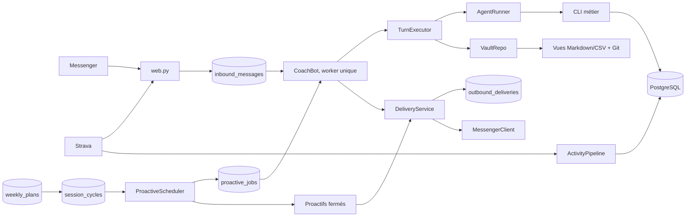

# Redline Messenger

A Messenger service that reads Strava, keeps its facts in PostgreSQL, maintains a Git vault
and speaks through a Codex or Claude Code agent.

This document also describes a reference deployment: the paths, the systemd unit names
and the `ubuntu` user are those of a real VPS, to be adapted before installing.
The overview, the path of a message and the invariants describe the system as it is.

Coaching policy does not live in the service. It belongs to `CLAUDE.md`,
the vault's owner notes and the schemas in `src/redline/model/`. The service
authenticates, schedules, persists and delivers.

## Overview



Webhooks answer quickly. A single worker then serializes messages, commands and
initiatives so that two turns never share an agent session, a worktree or a delivery.

### Path of a Messenger message

1. `web.py` verifies the Meta signature and the authorized PSID.
2. The message is inserted into `inbound_messages` with the `pending` state.
3. `CoachBot` groups texts sent close together. A few exact greetings and thank-yous
   are sorted locally as N0; any other phrasing goes to the classifier
   (Luna low, 10 s, no fallback: a failure counts as N1). A bounded packet of
   PostgreSQL facts is injected according to the resulting level. The morning message
   receives the same context.
4. `VaultRepo.sync()` merges only the remote commits that do not touch the
   runtime. A code change waits for a deployment.
5. `TurnExecutor` creates a `turn_id`, launches the agent (a single model call), then
   applies all the turn's PostgreSQL commands in one transaction, with three
   retries on a transient failure. A code file or a projection
   modified during the turn is restored without losing the notes or the commands.
6. The required weeks are re-read and validated; the vault notes are committed
   locally, without network.
7. `CoachBot` decides whether a canonical prescription accompanies the prose.
8. `DeliveryService` records the complete envelope (text, buttons) in
   `outbound_deliveries.payload`, then delivers via `MessengerClient`. A retry resends
   this envelope, never a new model turn.
9. The inbound message moves to `done`. A crash before this step makes it recoverable
   at the next startup.
10. Only after delivery, the worker regenerates the views, commits and pushes
    (`VaultRepo.publish`), then synchronizes the repository.

A photo or a document follows a different boundary: the webhook keeps only the Meta
URL for the duration of the retry, the worker downloads a bounded JPEG/PNG/WebP/PDF/TXT/CSV
into `var/attachments/` (0600), then launches a read-only agent turn.
The raw file is deleted in a `finally` and the URL is cleared from PostgreSQL. The coach returns
observations and possible candidate facts; only the next confirmation,
in a normal turn, can write them. Video and audio are refused without analysis.

An agent error or a refused persistence abandons the prepared commands and
restores the worktree. Facts already committed in PostgreSQL are never simulated
as rolled back because a projection or a Git push failed.

## Code owners

| Module | Responsibility |
|---|---|
| `app.py` | composition, startup checks and lifecycle |
| `config.py` | single read of `.env` and the environment at startup |
| `clock.py` | civil clock, in the time zone of `redline.toml` (`[athlete] timezone`); storage stays in UTC |
| `events.py` | structured operational events, one JSON line per step |
| `web.py` | HTTP routes, authentication and input normalization |
| `bot.py` | conversational orchestration and delivery policy |
| `work_queue.py` | serialization, priorities and debounce of inputs |
| `turns.py` | transaction of an agent turn and fail-closed abort |
| `plans.py` | pure reading and rendering of the weekly program |
| `vault.py` | domain access, projections and Git boundary |
| `agent.py` | common provider contracts, registry of work in progress, session resumption |
| `agent_factory.py` | engine choice at startup |
| `routing.py` | N0–N3 profiles, triage, deep, proactives and common fallbacks |
| `codex.py` | Codex SDK threads |
| `claude.py` | Claude Code CLI process |
| `state.py` | runtime storage contracts |
| `postgres_state.py` | sessions, inbox, jobs, quotas and durable markers |
| `relationship.py` | compact relational memory injected into the turn |
| `proactive.py` | materialization and selection of initiatives |
| `proactive_messages.py` | rendering of closed initiatives, without an agent |
| `activity_pipeline.py` | Strava capture, then replayable D-/WBGT enrichments |
| `attachments.py` | bounded Meta download, validation and deletion of the raw file |
| `race_countdown.py` | compilation of a race date into persistent milestones |
| `triage_rules.py` | local high-precision triage, before the model fallback |
| `delivery.py` | ordered envelopes, network journal and partial successes |
| `messenger.py` | Meta transport and delivery results |
| `textutils.py` | burst splitting, shared by the agent and the transport |
| `outbox.py` | lifecycle of images and sidecars |
| `strength_artifact.py` | strength card rendered from the typed prescription |
| `prompts.py` | choice of the texts injected at each turn and of the proactive workflows |
| `src/redline/coach/fr/` | the coach's and the service's words: `prompts/*.md`, `messages.py` (notes), `replies.py` (limits), `initiatives.py`, `notebook.py`, `session_labels.py`, `calendar.py` |
| `strength.py`, `page/` | opaque capabilities and strength page |
| `src/redline/storage/repository/` | transactions and operational facts, one module per aggregate |
| `src/redline/storage/projector.py` | regenerable Obsidian views |

To change a behavior:

- coaching tone, method or rule: `CLAUDE.md` or its owner in the vault;
- text injected by the service: `src/redline/coach/fr/`; when it is injected: `prompts.py`;
- send decision: `bot.py`;
- shape of the program: `src/redline/model/weekly_plan.py`;
- Messenger rendering of the program: `plans.py`;
- persistence of a fact: the module of its aggregate in `src/redline/storage/repository/`;
- schedule of an initiative: `proactive.py`.

## Invariants

- PostgreSQL is mandatory and canonical. Markdown and CSV are projections.
- An agent command always carries `REDLINE_TURN_ID`. The service applies or
  abandons all the commands of that turn together.
- Facts are unconditional. A program defect withholds the prescription,
  not the observations already recorded.
- An absent or invalid week removes any prescription: the coach is told to
  give none, no canonical block is sent, and a program request receives
  a precise line. Prose, including a safety precaution, is always sent.
- A stale week lets the coach speak but prescribes nothing.
- Staleness compares the effort activities not attached to the PostgreSQL watermark
  of the revision; it does not depend on an equality between fingerprint versions.
- A dated precondition holds back only the sessions named in `holds`. Older
  revisions without `holds` hold back the whole week as a precaution.
- The program sent is rendered from the persisted revision, never from the model's
  free prose.
- An explicit request renders only its scope (`today`, `next`, `remaining` or
  `full`) and can be repeated; a spontaneous revision renders only its delta.
- A raw measurement never carries its cause. Voluntary, prescribed or spontaneous
  exposures live separately and count only once confirmed.
- The plan carries the intention (`planned` or `cancelled`). What was done is projected from
  `session_cycles` and never writes `done` in a new revision.
- A captured Strava activity stays durable even if the stream or the weather fails.
  Each enrichment has its own state and its own attempt counter.
- Strength modulation is written in the plan: its delivery does not re-decide it.
- A proactive task is acknowledged only after an effective text delivery.
  A partial delivery is not replayed, so as not to duplicate the fragments
  already received.
- A refused outbound attachment is quarantined in `outbox/failed/`. It is not
  replayed with the text already delivered.
- An inbound attachment never has write rights: URL and raw file are
  ephemeral, its content is treated as untrusted data, and any memorization
  waits for a later text confirmation.
- A `sending` envelope found after a crash is not blindly replayed: Meta
  offers no idempotency key, so the service chooses at-most-once and flags
  the ambiguity in the logs. A `failed` envelope with no delivered fragment can be
  retried. `408`, `425`, `429` and `5xx` are retried by the transport.
- Silence, declarative cells, missed session, digestion,
  gear and operator message do not wake the agent; an unreadable detail
  moves the job to `failed` instead of calling the model.
- An initiative rendered by the agent follows the `{send, text}` schema: `send=false` is a
  deliberate silence, never deduced from the prose. It shows no typing indicator.
- `running` jobs and `pending` inbound messages are resumed at startup. A failed direct
  inbound stays `pending` and is retried after 30 s, 5 min, then every
  30 min (or at the return time announced by the provider), at most 48 times, then
  stays `pending` for the next startup. As soon as a retry has to wait more than
  two minutes, a single sentence (at most one every two hours) tells the athlete
  that the answer is coming; a late answer receives the age of the message so as not to
  treat it as current.
- Proactive messages are journaled by the service after delivery. The agent
  does not own this trace.
- Codex runs without a Linux sandbox in the service: bubblewrap is not a
  production dependency. The safeguards are application-level and stable: unprivileged
  Unix user, interactive approvals refused, purged agent environment,
  root-owned business CLIs, PostgreSQL transactions per `turn_id`, runtime
  path checks and read-only Git return. `SANDBOX_NEEDS` contains only the
  environment values the business CLIs need.
- The runtime is never updated from a turn. `VaultRepo.sync()` refuses any incoming
  commit touching `deploy/`, `src/`, `migrations/`, the hooks, the CI, the
  dependencies or the assets read at startup.
- **"Runtime" = the service behaves differently after this commit.** Neither
  `coaching/exercises/*.md` — data re-read at each call of
  `chart-strength.py`, and which the coach edits itself — nor `tests/` are runtime:
  neither requires a restart, and a test pushed with code is held back by the code anyway.
  Leaving them in would freeze vault synchronization on a perfectly legitimate
  write.
- **Internal diagnostics stay in the operational logs.** No adapter text
  (watchdog, turn, engine) is shown to the athlete: each failure class has
  a sentence for them, defined once in `bot.py`. If persistence of a reactive turn
  is refused, its prose is sent with a line naming what was not recorded
  (« ta séance », « ton état du jour »…); no program accompanies that turn. A push
  failure after a valid save remains an operational incident. Only data that is really
  unusable or expired — typically an attachment that Meta no longer serves — can
  ask to be resent. An invalid review stays open and resumes automatically;
  it is neither acknowledged nor announced as an incident.

## Local installation

Python 3.12 is required.

```bash
python3.12 -m venv .venv
.venv/bin/pip install -r requirements.txt -r requirements-dev.txt
.venv/bin/pip install --no-deps -e .
cp deploy/coach-messenger.env.example .env
```

Create or migrate PostgreSQL with the migration role, then launch from the root:

```bash
DATABASE_URL='postgresql+psycopg://…' alembic upgrade head
.venv/bin/python -m redline
```

Startup refuses:

- Python older than 3.12;
- incomplete Messenger configuration;
- unknown agent provider;
- invalid numeric, boolean, time, effort or route value (notably Sol Max);
- unavailable PostgreSQL.

`deploy/coach-messenger.env.example` is the exhaustive reference. Locally, a `.env` at the root is tolerated;
in production, the real file lives outside the checkout in
`/etc/redline/runtime/coach-messenger.env`, readable only by the service user.
The `AGENT_*` variables are the
only model, effort and timeout variables. `CLAUDE_CODE_OAUTH_TOKEN` remains specific
to authentication of the Claude provider. The Claude provider requires CLI 2.1.197+
and uses `--effort` and `--fork-session` directly.

## Endpoints

| Method | Route | Use |
|---|---|---|
| `GET` | `/webhook` | Meta challenge |
| `POST` | `/webhook` | signed Messenger events |
| `GET/POST` | `/strava-webhook/<secret>` | subscription, filtered creations and renamed titles |
| `GET` | `/s` | generic shell of the strength page |
| `POST` | `/strength-session` | resolution of an opaque capability, no HTTP cache |
| `POST` | `/strength-report` | per-capability report, claim, quota and atomic facts |
| `GET` | `/health` | liveness, deployed commit, `runtime_tree` fingerprint and uptime |
| `GET` | `/ready` | active worker, reachable PostgreSQL and schema at the Alembic head (local only) |

Every request body is capped at 1 MB by the service and by Caddy; the notebook and
strength routes go lower. The `hub.*` handshakes compare their token in
constant time and return the challenge as text or JSON, never as HTML.
`MESSENGER_VERIFY_TOKEN`, `STRAVA_VERIFY_TOKEN` and `STRAVA_WEBHOOK_SECRET` are at
least 32 characters long, otherwise the service refuses to start. Caddy adds HSTS and reserves
`/ready` for the VPS, since it queries PostgreSQL on every call.

### Strava subscription

Strava does not sign its events and the athlete id is public: the route is
authenticated only by the `STRAVA_WEBHOOK_SECRET` segment of the callback URL. A wrong
URL answers 404. Changing this secret requires recreating the subscription, after the
service restarts, because Strava validates the URL immediately:

```bash
set -a; . /etc/redline/runtime/coach-messenger.env; set +a
/home/ubuntu/.venvs/redline-current/bin/python deploy/strava-subscription.py renew
```

`status` returns 0 if the single subscription points to the expected URL. Neither
mode prints the URL or a secret.

The fragment no longer carries the session but a random 192-bit token. The
service stores only its SHA-256, with the exact, immutable snapshot delivered under the
card, then resolves it without an HTTP cache. The link expires after seven days and can be
revoked irreversibly. After a first successful opening, the browser keeps
the snapshot in `localStorage` to resume the session offline; an expiry
or a revocation confirmed by the server takes precedence over this cache. Old fragments
are not interpreted: a link must be an opaque capability known to PostgreSQL.

Claim, daily quota, session and debrief, durable inbound message, audit and projection
request are written in a single transaction. The page keeps the civil date
of the first attempt and retries with a bounded backoff. A database outage returns
`503` without consuming the claim; a crash after the commit leaves the message `pending`,
resumed at the next startup. The responses distinguish `accepted` (`201`),
`duplicate` (`200`), `quota` (`429`), expired link (`410`) and invalid report (`400`).

The page also saves drafts, timers and the last cancellable validation.
Resuming interrupted work time asks for confirmation; an automatic
chain stays limited to the sets of the current exercise and starts
no work while the page is hidden. The end-of-work and rest signals
have distinct patterns, a persisted intensity and a test button.

Sets validated before a stop stay logged with their position and their
side, a `partial` state, their count and the exercise-specific remark. Exercises
removed by the guard stay viewable without being executable or evaluable.
The exact prescription is kept with the report: preparation compares the
last reported prescription of the same type, separately from the performances achieved.
Histories without a snapshot give rise to no reconstructed comparison.
The report is frozen on sending and network retries reuse the same content;
after receipt, a correction is explicitly sent in Messenger.

A strength report completes the planned cycle when a single session and a single report
share the date and the A/B type, without copying the report into the ledger or inventing an
end time. This matching also runs before missed-session detection
for historical reports. An ambiguous match completes no cycle and
justifies no absence follow-up. The cause of a follow-up is re-verified when sending.

## Sessions and commands

Triage classifies each message from N0 to N3. It chooses the reading volume and the
tone indicators, then the same decision selects a model and effort profile.
Only a few exact greetings are recognized locally; everything else goes to the
classifier, which has neither a shell nor project documentation. A failed or
timed-out triage counts as N1 with no effort escalation. An expressed emotion requires neither a
welcoming sentence nor a question: the latest request sets the posture, and a concrete request is
handled with the usual checks. The level sets what is read, not the length
sent: a verified correction at N3 can fit in one sentence, and a contested simple fact
is re-read at its owner, not in the literature. A social closing
opens no new topic; at N0, an observation of the day forces neither a prescription
nor a question, whereas a blocking check travels whole at every level. Static waiting phrases promise neither a delay
nor access to a source; contextual phrases follow the same triage instruction.
The configuration is common to Claude and Codex (`redline/routing.py`). The default provider
is Codex, with the identifiers GPT-6 Luna and Sol:

The answer produced by the coach is sent directly after the service's deterministic
gates: successful persistence, valid PostgreSQL plan when a prescription is requested,
dated checks, staleness and canonical rendering. There is no second model call
before transport, including when the turn applied commands. An
unreadable week does not erase the answer: it only removes the prescription and adds a
precise line. A turn that ends without text receives a single retry in the same session. A second judgment would hold back correct answers when it
lacked evidence or when it timed out, add latency and break the continuity
of the conversation without being able to guarantee medical accuracy.

Probabilistic semantic judgment lives in the `evaluation/` package, outside `redline/`,
and is called only by `evaluate-coaching.py`, an explicit evaluation bench. It is used to confront red cases and to
improve the coach's instructions; its unavailability or its verdict can never
hold back a Messenger conversation. The coaching limits (diagnosis, medication,
painful tests, inferred scores and identity) belong to the coach's instructions and
to the evaluation scenarios. The protections on writes and on the program remain
deterministic code.

`python -m redline.cli.evaluate_coaching --output /tmp/coaching-evaluation.json` produces fictitious
answers with the profiles of the provider in `AGENT_PROVIDER` (Claude in production: the
scenario's route, judge on the N2 profile), with no tool, persistent memory or sending.
`ClaudeCodeRunner.one_shot` launches `claude -p` in an empty folder, hence without `CLAUDE.md`,
like the Codex bench; `evaluation/runner.py` bounds the billable models.
The fixtures `tests/fixtures/coaching-scenarios.json` carry 36 scenarios, their
context, posture, illustrative answer and acceptance criteria; those that originate from a
real correction name their origin (`origin`), checked by `test_coaching_scenarios.py`. The vault's `coaching/corrections-replay.json` registry gives each entry of
`coaching/corrections.md` its replay mode; `vault-check.py` flags those still waiting
for a scenario (`a-rejouer`). The routes are imposed
by the fixtures and the reads replaced by fictitious facts: this bench evaluates
the wording, not the real routing nor the effects of the tools. Human review remains necessary;
the question and paragraph counters do not measure naturalness. With
`--fixtures tests/fixtures/coaching-review-cases.json`, the same tool tests thirteen
expected verdicts and fails on a disagreement. These explicit calls are billable, outside CI;
the deterministic tests separately cover memory, tool failures and transport.

The bench also fails on an empty answer, an overrun of the form budgets or
a judge refusal on a generated answer. The `emotional` flag of the fixtures controls
emotional injection; the bubbles follow the transport's shared splitting.

`python -m redline.cli.evaluate_conversation` complements this bench with twelve situations and twenty-one
turns. It feeds the produced answers back into the next turn, offers a
`contextual` variant limited to evaluation, and compares two result files offline
with a blind reading grid. `--dry-run` exports the content without a model
call; `--only` and `--repeat` bound the experiment. It runs no real triage,
no business tool, no Messenger sending. The counters describe form, without
automatically designating a more natural answer; the procedure, its limits and the reading grid
remain in the bench code (`evaluation/`) and its fixtures.

| Route | Codex | Codex fallback | Claude | Claude fallback | Session |
|---|---|---|---|---|---|
| triage | GPT-6 Luna / low | — | Haiku 5.5 / low | — | isolated, read-only |
| N0 | GPT-6 Luna / medium | GPT-6 Luna / high | Sonnet / low | Haiku 5.5 / low | continuous |
| N1 | GPT-6 Luna / high | GPT-6 Luna / high | Sonnet / low | Opus / medium | continuous |
| N2 | GPT-6 Sol / medium | GPT-6 Luna / max | Sonnet / high | Opus / high | continuous |
| N3 | GPT-6 Sol / high | GPT-6 Luna / max | Opus / medium | Sonnet / high | continuous |
| `/deep` | GPT-6 Sol / high | GPT-6 Luna / max | Opus / high | Sonnet / high | ephemeral fork |
| heavy proactive | GPT-6 Sol / high | GPT-6 Luna / max | Opus / high | Sonnet / high | isolated |

On the Claude side, Haiku is pinned to `claude-haiku-5-5`: the stable CLI's `haiku` alias
still resolves to Haiku 4.5. Sonnet and Opus follow their alias, which the nightly preflight displays.
N0 to N2 share Sonnet so that the continuous session keeps its cache, which is specific to each
model, and each fallback changes model so as not to fall back on the same quota.

Triage has no fallback: a failure or an overrun of `TRIAGE_TIMEOUT` (10 s)
counts as N1. Each other row has a single explicit fallback, reserved for preflight or
quota failures before any useful work. Once a turn has started, an in-flight failure, `/cancel` or the
watchdog is terminal: no other model restarts the work and the inbound message is not
replayed. The preflight fallback stays transactional. At N1, it retries Luna High only once
before any useful work, without raising the model's cost. The default Codex identifiers
are `gpt-6-luna` and `gpt-6-sol`, including for overrides and fallbacks. These are the
model names currently published by OpenAI; they do not mean "Luna/Sol, whatever the
generation" and will not switch automatically to a future generation. Efforts
and watchdogs stay optimized for cost, even at the price of latency. Sol Max
(Sol with `max` or `ultra` effort) is refused at startup, including for a fallback.
The proactive window starts at `PROACTIVE_ACTIVE_START` and runs until midnight: it
has no configurable end, and no work duration is checked against the end of
the window.
The variables `AGENT_<ROUTE>_MODEL`, `_EFFORT`, `_FALLBACK_MODEL` and
`_FALLBACK_EFFORT` allow overriding each row; the old flat variables
`AGENT_MODEL*`/`AGENT_EFFORT*` are no longer read.

The ordinary session expires according to `SESSION_TTL_HOURS` and stays tied to its provider and
to the fingerprint of its instructions (`prompts.instruction_digest`): the style prompt and
the content of the owners read from disk, `CLAUDE.md` and `AGENTS.md`. A change
to any of them abandons the thread at its next turn; a commit of notes, journal or
hot-cache does not. Changing route does not change this rule: the model and
effort are passed on each turn, while `/deep` and the heavy reviews keep
their ephemeral or isolated context.

Available commands:

- `/help`;
- `/status`;
- `/cancel`;
- `/renfo` to resend the card prescribed today;
- `/clear`;
- `/deep <question>` for a one-off heavy fork.

`/status` and `/cancel` bypass the worker so as to stay available during a long
turn. The other commands stay serialized. `/clear` explicitly settles the
buffered messages it abandons. The typing indicator turns on as soon as the message is
received, before triage. After 75 seconds, a single waiting sentence is sent, whatever the
level; it is stored in the conversation like a real message. After
90 seconds, an N2/N3 turn only stops refreshing the indicator.

## Weekly program

The program belongs to PostgreSQL and its revisions are append-only.

```bash
python -m redline.cli.week_plan show --week 2030-W33
python -m redline.cli.week_plan check --week 2030-W33
python -m redline.cli.week_plan revise --week 2030-W33 < revision.json
```

Codes of `check` and `show`:

- `0`: prescribable;
- `1`: absent or invalid;
- `2`: valid, but a dated precondition is waiting for an answer;
- `3`: stale, to be revised before prescribing.

The canonical block is sent only if what remains to be done has changed, if the athlete
asks for it, or if a delivery debt exists. The revision number alone is not
enough: a revision may record only the past.

The read-back of `revise`, `preview` and a prepared change displays the gap between each
upcoming race and the longest run of the previous 30 days. It is informative and blocks
nothing: no fixed percentage bounds the long run. The rules in force, one
line each, their thresholds and the kinds of transition live in `rulebook.toml` at the
root of the vault; without it, the engine applies `rulebook.default.toml`, which a vault
replaces entirely, never partially. `src/redline/model/rulebook.py` validates it (the service
refuses to start on a non-conforming rulebook) and re-reads it if it changes. The context
packet injects it at every N1+ turn and at the review.

An active strength prescription is resolved against the real session sheets
during validation: unknown variant, removals and guard block the revision
before activation. The morning message then arms a durable `strength_card` task,
identified by week, revision, session and date. This task and `/renfo` render the
card directly from the typed plan; they build no prompt and
never call the agent. Each tick rematerializes the day's debt with the same
identity, which also recovers a missed morning message or a restart. Delivery
reuses the idempotency of the outbound envelope.

## Proactivity and delivery

The scheduler materializes jobs with a stable identifier: Strava debrief, morning message,
weekly review, monthly look-back, resumption after silence and cell follow-up.
A plan session can carry a local `start_time` `HH:MM`; if absent, no
time is invented. The calibration game (previous day's prediction, D+1 in quick
replies) is discontinued; its tables remain readable.

Before the weekly review turn, the service computes a dossier
(`redline.analysis.weekly_dossier`) with the same functions as the CLIs: closed week,
long-run trajectory and stagnation, signals, due predictions,
due deadlines, capabilities. It injects it with the N2 packet; a failed
computation replaces it with a line pointing to the CLIs, without holding back the review. The projector
creates the journal of the current week and of the next one when a program exists.

The period of a review belongs to its durable key: `weekly:2030-W34` closes W34 and
prepares W35, even if a retry only starts on Monday. A failed initiative is
claimed at most three times (5, 15 then 45 min apart, or the return time announced
by the provider), always with an expiry; beyond that it goes `failed` with its
cause in `last_error`, distinct from a successful send. A text already written is never
regenerated by these retries. From Monday to Saturday, a current week without a valid
program arms an isolated `weekly-repair:<semaine>` job, which must leave a valid
revision. After an operator repair, a finished or failed job reopens without ad hoc
SQL, and this command is deliberately kept outside the coach's sandbox:

```bash
python -m redline.cli.proactive_job status --job-key weekly:2030-W34
python -m redline.cli.proactive_job reopen --job-key weekly:2030-W34
```

Operator commands run from the root, with the service's environment
(`DATABASE_URL` and the venv's python): on the reference deployment, an SSH wrapper
on the local workstation carries them; this edition ships the CLIs, not the wrapper.

A text written outside the service (a review done from the Mac) goes through the same chain,
without a model turn, with `operator-message.py`: closed `operator_message` job,
high priority, stale after 6 h, idempotent by its key, traced in conversation memory.
Operator command, outside the coach's sandbox:

```bash
python -m redline.cli.operator_message --key bilan-w39 --text "…"
```

`session_cycles` gives each `plan_id + logical_key` a stable identity across the
append-only revisions. A new revision resynchronizes the cycle and keeps its state
if the relevant fields have not changed; a cancelled or removed session loses its pending
digestive follow-up. `session-cycle.py` records an optional declared
departure and an explicit match.
The Strava observation carries the real time: it replaces the effective time, keeps
the declared departure as a trace and retroactively closes the session if "I'm going"
was forgotten. An ambiguity of date and type stays unmatched until the athlete chooses.
The webhook wakes the scheduler, which immediately captures the distillate and its laps in
`strava_activity_intakes`: the outing enters the ledger and the notebook can ask for its
feelings before the debrief. The debrief goes out at the first sign that the athlete is done: title
renamed in Strava (`update` event, title and description are recorded together),
complete feelings in the notebook, or a Messenger message, whose answer then carries the
debrief instead of pushing it back by eight minutes. Otherwise it goes out after
`STRAVA_DEBRIEF_DELAY`. The service injects into the debrief a bounded snapshot of this
persistent fact, title and description re-read just before, feelings already given included: the
model does not redo the Strava call and a restart re-reads the capture before any network.
A failed capture is retried every minute for three minutes, then every 5 min.

The same materialization turns the other typed facts into idempotent initiatives:
missed session, daily signal, race pre-mortem, digestive follow-up, gear
wear, spontaneous correction and contradiction of a load increase. A correction
is announced within 7 days of being recorded, or never: the announcement expires
and `fact-read.py corrections` says so, with the number of recurrences drawn from the audit log.
`fact-write.py correction` requires `--entry`, the title of an entry already written in
`coaching/corrections.md`. Only
`race` deadlines trigger a scenario; an `availability` mechanically forbids a
demanding session in its range. Pre-session reminder, timed mental cue, weather alert and
medical appointment have been removed (migration `0039`).

The latest delivered exchanges and the open questions live in
`conversation_messages` and `conversation_questions`. A question is opened only by
an applied `question.ask` command whose text appears in the delivered message; prose
alone creates none. A question left open for fourteen days without review is
closed as `expired` during maintenance. This dated memory is injected
at every turn: eight exchanges with their identifiers, at most twenty questions and
the retained topics. Service lines (waiting, outage, limit) stay in the database
but do not count among the eight. At N2 and N3, the business packet already carries the open
threads: the memory does not render them a second time. The last twelve closed questions stay visible with their
answer or their limit, to avoid asking them again. Long texts flag their
shortening and keep their end. `fact-read.py conversation --query <sujet>` searches
past exchanges in French and gives the dated message with its neighbors. The service
binds the turn to its PSID in `turn_scopes`; the CLI refuses a missing or expired turn, without
exposing the Messenger identifier to the shell. `knowledge-search.py --query <sujet>` locates the
theory sheets; its result is an index to open, not proof already read.
`fact-read.py questions --limit 1000` makes it possible to find older questions.
A common word, a number, a yes or a Messenger reply closes no question.
The coach explicitly reviews the answer with `fact-write.py question`, which carries the
question and message identifiers, a note and a state: `open` for a partial
answer, `answered` for a sufficient answer, `deferred` for a later resumption
and `expired` for a closed topic. A resumption date is recorded only if agreed.
The note keeps what was understood and what is missing; no partial answer
automatically becomes a complete answer. The review is transactional and requires
a later message from the same person. A recorded correction
is matched to the inbound text by lexical overlap and is spontaneously pushed
only once.

The model's questions are declared by `fact-write.py ask --text ...`, with only the
`--cell` keys requested. Their exact text must have been delivered before creating
the question and its markers; a simple answer no longer marks all feelings
as asked. Follow-up is reserved for an expected piece of information: a social
or rhetorical question is not declared. A closed rendering has no turn; it names itself the
question it expects (`ClosedProactive.question`), created after confirmed delivery under
the same condition of presence in the text sent. Before sending, the service gives up
if this exact question is still open or deferred, or was settled less than three
days ago. Checking in after a silence and the operator message open no
question.
Missing information does not force a questionnaire and is not injected
into an N0 or emotional turn. A deferred follow-up re-reads the still-unknown cells,
discards those already asked and asks only one, effort pain first.
The context packet distinguishes an empty section from a failed PostgreSQL read,
and keeps the other available sections. It dates the read, identifies the historical
daily states and flags that an old night or one with an inconsistent date does not
describe tonight. Objective measurements and declared feeling remain distinct:
a contradiction calls for a check of the sources, never an implicit merge.

Initiatives re-verify the pending inbound messages, the reactive turn in progress and the
eight-minute silence delay before their preparation and then before sending. A resumption
of the conversation puts the job back on hold without destroying its text: the prepared envelope
is kept and delivered later without a new model turn, unless the program revision
changed in between. Light initiatives work in a fork of the
conversation, heavy reviews in an isolated session; none erases the conversational
session. Facts already validated stay recorded. Automatic cards and locally composed messages also follow
this activity check. It applies to received messages, not to typing a draft.
A partial send stores only the confirmed fragments, does not mark the unrequested
measurements and is not replayed in full. A send already committed to the Send API
cannot be recalled.

A Messenger swipe-reply remains an explicit relationship end to end. The webhook keeps
`message.reply_to.mid`, while each text accepted by the Send API keeps its MID and
its exact chunk in `messenger_message_refs`. At the next turn, the quoted message is
injected as targeted context without modifying the raw text used by triage. A
reference older than this retention is flagged as unknown: it is never
reconstructed by guesswork.

Decision predictions have a probability, a deadline, a verdict and a
Brier score. Any concrete increase of a target or a cap in a later revision
requires an already challenged `direction=increase` prediction; this authorization is
consumed by a single revision. The refusal is therefore transactional, not an instruction
the model can forget.

```bash
python -m redline.cli.session_cycle pending --week 2030-W34
python -m redline.cli.session_cycle reconcile-strava --days 30
python -m redline.cli.fact_read predictions
python -m redline.cli.fact_read gear
```

Normal cycle: `pending` -> `running` -> `done`. An error before delivery puts the
job back on hold with a bounded expiry. At startup, jobs left `running`
become `pending` again.

Detection and send pacing do not journal a send. There is no daily
cap on initiatives: each job keeps its own relevance via
`expires_at`. Only after delivery does the service store the time of the last send,
finish the job in a single transaction, then add `proactive_messages`.

## Projections and Git

Each fact mutation marks `projection_states` as dirty. The projector regenerates
all views under a PostgreSQL lock, runs the static generators, then acknowledges
the state only if everything succeeded.

Git versions these views and the vault notes. A turn makes only a local commit; view
regeneration, the commit of projections and the push happen after delivery
(`VaultRepo.publish`), or during worker maintenance every ten minutes. A push
that cannot go through leaves a valid local commit, raises an alert and is retried on the next
pass. Remote synchronization happens between turns and merges only commits
without a runtime change.

## Deployment

### Two accounts

The service never runs as the account that deploys it. A coaching turn can write
files, so everything the service can write is something a turn can write:

| Account | Owns | Writes |
|---|---|---|
| `ubuntu` (deploy, sudo) | the engine checkout, the venvs, the Claude runtime | deployments, the nightly runtime update |
| `redline` (service, no sudo, no login) | `/var/lib/redline`: the vault, `state/` (outbox, attachments, Strava token), `~/.claude` | notes, cards, sessions |

The unit (`deploy/systemd/coach-messenger.service`) makes the rest of the file system
read-only (`ProtectSystem=strict`, `ProtectHome=read-only`). `redline-agent-cli` refuses to
run if the service account can write the engine's `src/` or the venv, and every
`claude` call is confined (`--restricted`): no settings file, hook or MCP server written
by a turn is ever loaded, and the file tools stay inside the vault.

```bash
sudo useradd --system --home-dir /var/lib/redline --shell /usr/sbin/nologin redline
sudo install -d -o redline -g redline -m 0700 /var/lib/redline /var/lib/redline/state
sudo -u redline git clone <vault remote> /var/lib/redline/vault
```

The vault's Git credentials (a deploy key with write access to the vault repository
only) belong to `redline`.

### Release

Deployment is external to the service: prior backup, repository update,
dependency installation, migrations, checks, systemd restart, verification
of the commit **actually started**, then post-deployment backup. An HTTP 200
alone does not prove that the new code is running.

`Type=simple` only confirms that the Python process was launched: Waitress may
still be opening the port. The unit therefore runs `deploy/wait-ready.sh` in
`ExecStartPost` and completes the systemd startup only after an HTTP 200 from `/ready`. The
release verifier reuses the same bounded 90 s delay before checking the
commit, storage, schema and worker. It also requires the expected commit to be
an ancestor of the checkout with no runtime difference, and compares the fingerprint of the engine's
`deploy/`, `src/` and `migrations/` trees to `runtime_tree` from `/health`: a vault commit
laid on top does not fail the verification, different code does. A slow start waits; a readiness
that really does not come back fails the startup with the last visible HTTP code.

The Python service uses `/home/ubuntu/.venvs/redline-current`, a link to the active
venv. The `redline-agent-runtime-update.timer` timer updates every night at 03:00, Paris
time, the runtime of the only provider the service reads (`AGENT_PROVIDER`, read like
systemd: unit then environment file). `deploy/agent-runtime-update.py` carries a single
transaction and two adapters:

| | Codex | Claude |
|---|---|---|
| Target version | latest stable `openai-codex` in `requirements.txt` | Anthropic npm `stable` channel, bounded by `deploy/claude-runtime.txt` |
| Candidate | venv `~/.venvs/redline-codex-<version>-<empreinte>` | npm prefix `~/.claude-runtimes/claude-code-<version>` |
| Switched link | `~/.venvs/redline-current` | `~/.claude-runtimes/current`, at the head of the service `PATH` |
| Preflight | `codex-runtime-smoke.py` | `claude-runtime-smoke.py`, with the service's exact identity and environment (`systemd-run`) |
| Activation | restart, `/health` and `/ready` | no restart: each turn launches a new `claude` |

Candidates are built as `ubuntu`, never as root. Both preflights read the
models from `redline.routing.default_models`, the repository's only list; the Claude preflight
displays the identifier each alias resolves to, resumes with the candidate a session
written by the active one, then requires a coach CLI call (`week-plan.py preview
--input <turn file>`) to pass the exact permissions of an autonomous turn
(`redline.claude.AUTONOMOUS_PERMISSIONS`). Any failure after the switch restores the previous link. A refused
update stays visible in `journalctl -u redline-agent-runtime-update.service`; the
next night retries. Claude Code auto-update is turned off (`DISABLE_AUTOUPDATER=1`)
: only this transaction promotes a version. Without a managed Claude link, the `PATH` falls back
to the global npm installation, which then serves only as a seed. The legacy venv
`redline-3.12` is kept as a fallback.

```bash
cd /home/ubuntu/redline
for unit in redline-codex-runtime-update redline-agent-runtime-update; do
  if systemctl cat "$unit.service" >/dev/null 2>&1; then
    sudo systemctl stop "$unit.timer"
    while sudo systemctl is-active --quiet "$unit.service"; do
      sleep 2
    done
  fi
done
# One-time migration: the old Codex timer is replaced by the generic timer.
sudo systemctl disable redline-codex-runtime-update.timer 2>/dev/null || true
sudo rm -f /etc/systemd/system/redline-codex-runtime-update.{service,timer} \
  /usr/local/sbin/redline-codex-runtime-update
git fetch origin main
git merge --ff-only origin/main
RELEASE_SHA=$(git rev-parse HEAD)
sudo systemctl start redline-backup.service
sudo systemctl is-failed --quiet redline-backup.service && exit 1
sudo install -d -o root -g ubuntu -m 0750 /etc/redline/runtime
test -r /etc/redline/runtime/coach-messenger.env
sudo install -o root -g root -m 0755 deploy/redline-agent-cli \
  /usr/local/bin/redline-agent-cli
sudo install -d -o root -g root -m 0755 /usr/local/share/redline
sudo install -o root -g root -m 0644 deploy/agent-cli-tools.txt \
  /usr/local/share/redline/agent-cli-tools.txt
sudo install -o root -g root -m 0755 deploy/postgres/export-latest-backup.sh \
  /usr/local/bin/redline-backup-export
if [ ! -e /home/ubuntu/.venvs/redline-current ] && \
   [ ! -L /home/ubuntu/.venvs/redline-current ]; then
  sudo -u ubuntu ln -s /home/ubuntu/.venvs/redline-3.12 \
    /home/ubuntu/.venvs/redline-current
fi
test -L /home/ubuntu/.venvs/redline-current
test -x /home/ubuntu/.venvs/redline-current/bin/python
sudo install -o root -g root -m 0755 deploy/agent-runtime-update.py \
  /usr/local/sbin/redline-agent-runtime-update
sudo install -o root -g root -m 0755 deploy/codex-runtime-smoke.py \
  /usr/local/libexec/redline-codex-runtime-smoke.py
sudo install -o root -g root -m 0755 deploy/claude-runtime-smoke.py \
  /usr/local/libexec/redline-claude-runtime-smoke.py
sudo install -o root -g root -m 0644 deploy/systemd/redline-agent-runtime-update.service \
  /etc/systemd/system/redline-agent-runtime-update.service
sudo install -o root -g root -m 0644 deploy/systemd/redline-agent-runtime-update.timer \
  /etc/systemd/system/redline-agent-runtime-update.timer
sudo install -o root -g root -m 0644 deploy/systemd/coach-messenger.service \
  /etc/systemd/system/coach-messenger.service
sudo systemctl daemon-reload
/home/ubuntu/.venvs/redline-current/bin/python -m pip install \
  -r requirements.txt
/home/ubuntu/.venvs/redline-current/bin/python -m pip install --no-deps -e .
MIGRATOR_DATABASE_URL='postgresql+psycopg://redline_migrator:…@/redline?host=/run/redline-postgres'
DATABASE_URL="$MIGRATOR_DATABASE_URL" \
  /home/ubuntu/.venvs/redline-current/bin/alembic upgrade head
/home/ubuntu/.venvs/redline-current/bin/python -m ruff check .
/home/ubuntu/.venvs/redline-current/bin/python -m mypy
/home/ubuntu/.venvs/redline-current/bin/python -m pytest -q
sudo systemctl restart coach-messenger
REDLINE_PYTHON=/home/ubuntu/.venvs/redline-current/bin/python \
  deploy/verify-release.sh "$RELEASE_SHA"
/home/ubuntu/.venvs/redline-current/bin/python -c \
  'from importlib.metadata import version; print("openai-codex", version("openai-codex"))'
sudo systemctl enable --now redline-agent-runtime-update.timer
sudo systemctl start redline-agent-runtime-update.service
sudo systemctl is-enabled --quiet redline-agent-runtime-update.timer
sudo systemctl start redline-backup.service
sudo systemctl is-failed --quiet redline-backup.service && exit 1
```

Both backups must produce a valid archive, manifest and checksum.
In the reference deployment, off-VPS collection is a private GitHub Actions
workflow: it fetches the archive, does not hold the `age` private key and therefore cannot
claim to restore it. After a change to the backup chain, then at
least once a month, the Docker drill described in `docs/storage-architecture.md`
actually restores the latest archive. Adapt the checkout to the real
deployment mechanism. Never have these steps carried out by a user message or an
agent process.

### Adding a CLI the coach can use

A new module under `src/redline/cli/` is **refused by default**: automatically making
every future command executable would turn the whole directory into an implicit capability.
If it is needed in a Messenger turn, add its name to
`deploy/agent-cli-tools.txt` and reference it in the relevant prompt. The tests reject
a missing, unsorted or nonexistent entry, or a CLI cited by the prompts but left out
of the manifest. Deployment installs this manifest outside the vault as `root:root`; the
coach therefore cannot widen its own permissions.

## Validation

```bash
.venv/bin/python -m ruff check .
.venv/bin/python -m mypy
.venv/bin/python -m vulture
.venv/bin/python -m pytest -q -rs
python -m redline.cli.vault_check
```

`vulture` reads the production code without the tests (configuration in
`pyproject.toml`): a function that only its own test calls is dead code.
A false positive is declared by name in `ignore_names`.

PostgreSQL tests run when `TEST_DATABASE_URL` points to a migrated test
database with an administration role; otherwise they are reported as skipped.

## Host: firewall, updates, SSH

`deploy/host/` carries the machine's configuration (firewalld, automatic
updates, SSH). `sudo deploy/host/install.sh` validates then installs it,
without restarting any application service.

- **Firewall**: firewalld, `public` zone (ssh, http, https, dhcpv6-client), a second
  layer behind the Oracle Security List; the Docker interfaces are in the
  `docker` zone. Reading: `sudo firewall-cmd --list-all`. `rpcbind` is masked.
- **Updates**: `unattended-upgrades` also covers Caddy and Docker. Download
  at 03:20, installation at 03:40, reboot at 04:00 if a kernel requires it: this is the
  VPS's activity trough. The service, Caddy and Postgres restart on their own.
- **SSH**: key only (Oracle image), `X11Forwarding no`, `MaxAuthTries 3`,
  fail2ban active.

Check: `systemctl list-timers 'apt-daily*'`,
`sudo tail /var/log/unattended-upgrades/unattended-upgrades.log`, `last -x reboot`.

## Diagnostics

```bash
sudo systemctl status coach-messenger
sudo journalctl -u coach-messenger -n 200 --no-pager
curl -s http://127.0.0.1:8000/health
curl -s http://127.0.0.1:8000/ready
```

Order of verification:

1. configuration and PostgreSQL connection at startup;
2. `redline.events` events (one JSON line per step, no message text):
   `triage`, `model`, `apply`, `shape`, `deliver` share the `turn_id` of a turn;
   `shape` measures the envelope (bubbles according to the transport's splitting, characters of
   prose, parts and characters added by the service, question marks), with
   no text at all; proactive jobs carry `job_id`, `kind` and `outcome`;
3. `Incident interne` lines, projection or push failures;
4. `week-plan.py check` for the weeks cited;
5. `vault-check.py`;
6. `inbound_messages`, `proactive_jobs` (`failed` + `last_error`) and `projection_states`
   read-only;
7. timer and age of the latest encrypted PostgreSQL backup.

Historical decisions stay in Git. This document describes only the current
system.

The context packet separately keeps up to eight earlier morning readings
over 56 days, even if the last ten observations are all activities. These dated
markers are not a measurement of the day. Memory
and checks distinguish a sufficient answer from an impossible certainty: partial
answers accumulate, an estimate keeps its reservation and an impossible collection
closes without automatically lifting a safety condition.

## Private notebook

`/carnet` is a dashboard in three sections, with the card style and the
structure of an iOS app: a floating glass tab bar, a top bar
(back on the left, settings on the right, solid background like the iOS status bar) and a large
title that collapses into it on scroll.
Each section is a root; everything else is pushed on top and steps back one notch
as in UINavigationController: the pushed screen arrives from the right, the previous one
steps back by a third while darkening, and going back (round button, re-tapped tab, or
swipe right from anywhere, as on iOS 26) does the reverse; the tab
bar stays fixed. Pushed screens
do not enter the browser history: its gesture used to carry a snapshot of
the whole page, tab bar included. Each tab keeps its stack; re-tapping the active tab returns to its
root, then to the top. **Aujourd’hui** is a thread (mockup A): the
steps of the day in order, linked by a rule, and a single red dot on the first
one waiting for a gesture. The morning point (trace, sleep, life load) before 14:00, the
late feelings from another day, the session done (done set against the caps, then its
feelings one question at a time, and the question about a high HR), the upcoming session
(instruction, then before leaving: weather at the planned time, night, HR alert to set),
the strength session and its button. A rest day fits on one line and tomorrow's card follows
in full. Then **À venir** (one line per day, the weather for tomorrow only) and
**Repères**, three tiles that lead to the detail: the week as mini-bars (to
Semaine), the pain peak against the cap (Douleur screen, `GET /carnet-api/injury`: one point
per rated session and the wake-up readings over five calendar weeks, the athlete's scale, the
peak per week, wake-ups without a rating; no verdict), the countdown (to Course). The weather gives the sky and the felt temperature at departure, then the night relative to the
session (before, during, after), with a colored pictogram in a pill tinted with the
sky at departure (WMO code, day or night). The iOS (26+) status bar
copies the topmost opaque element at the top edge: the top bar stays alone there
and takes the state's color itself (veiled under the settings sheet,
black with close and share under the viewer); `theme-color` is used only at
launch. **Semaine** always opens on the current week:
a number (km done against the target), a bar, the week in bars (solid = done,
dotted = planned), then seven lines, one per day, with a
single number (what was done in ink, what was planned in grey) and an overrun in one red
sentence; a completed outing opens its **session detail**, the rest (planned, skipped)
unfolds on touch, one day at a time. At the bottom, past weeks (`GET /carnet-api/weeks`: the
ledger's fact and the revision's target) are pushed like screens, with their review.
The **session detail** (`GET /carnet-api/session/<observation>`, also from the session
done in Aujourd'hui) is computed by `redline/session_detail.py`: the head (distance,
time, pace, the session as a bar), the feeling (the question in one gesture while any
is missing), planned against done, then the repetitions of a quality session (read from the laps
like the card, `debrief.lap_blocks`) or the kilometers of another outing, HR on the
background of its zones, time per zone, the previous session of the same type, weather,
shoes and the week. The light streams and the hourly weather are fetched from Strava and
Open-Meteo on first display, then kept in `strava_activity_intakes.streams` and
`.weather`; an outage leaves the screen without its chart. The zones are those of
Karvonen (`src/redline/model/hr_zones.py`) on the resting HR and max HR of
`redline.toml`, never Strava's. On a
quality session, the reserve (guard rail no. 6) is declared in one gesture while the session is in its
completeness window: `reserve:<observation>` writes the `reps_in_reserve` measurement.
**Course**: D-N, longest outing, milestones, capabilities, archives.
`redline/notebook_board.py` computes everything at read time: the active revision carries
the intention, the ledger the fact, `ledger.py` and `signals.py` the counts.
No figure is stored for the notebook; an absent program prescribes nothing, an overdue dated
check holds back its sessions, a revision to re-arbitrate says so. The notebook
compares the fact to the typed caps (`hr_cap_bpm`, `rpe_max`, `duration_cap_min`,
`distance_cap_km`) and displays `volume_target_km`; it never reads `hr_zone` nor the
prose constraints, and on a revision change it shows only what moved and
when (the context is written for the coach). The weather comes from Open-Meteo through
`GET /carnet-api/weather`, after display, for the session's `location_label` or
`[notebook] place` from `redline.toml`, with the sky's WMO code and the day or night of
each hour; an unavailable forecast shows nothing.
A deadline appears there only if it carries `athlete_label`.

`POST /carnet-api/answer` writes in one gesture what the ledger still asks for: RPE,
pain to the half point and enjoyment of a session within its completeness window, and the
wake-up trace (none, light, sharp) before 14:00 the day after an effort, the
sleep and life load of the day before 14:00 (`daily_checkins`, completed without
erasing the row), and the explanation of a high HR at a comparable pace on an EF of the
last two days (`signals.hr_at_pace`): written into the state of the day of the outing,
« rien de spécial » goes to the coach. The
request is recomputed on write; once closed, it is refused (409). The trace goes
through `complete_measurement` or a `wake-trace` observation (`carnet:reveil:<date>`). An
effort pain above 2 or a sharp trace is passed to the coach as a
message, so that it answers; the other answers cost no model turn. The Messenger
menu « Mon carnet Redline » and the `/carnet` command give a single-use login link,
valid for 24 h. The fragment is erased as soon as it is opened; the browser
receives a `__Host-` cookie, Secure, HttpOnly, SameSite Strict, valid for one year. The database
keeps only the fingerprints of the capabilities. `/carnet-revoquer` revokes all
devices and links; logging out in the notebook revokes only the current device.
An old link to a card stays usable on an already logged-in device.
In the Messenger (or Instagram) in-app browser, whose cookie does not carry over to
Safari, the page does not consume the link: it offers to open it in Safari
(`x-safari-https:`), to copy it, or to log in here anyway.

The `/carnet-api/*` routes require this cookie, including for images. They are
without HTTP cache and without CORS; POSTs refuse a foreign origin. The document,
the install manifest and the icons are public but contain no personal
data. A service worker (`/carnet-sw.js`, scope `/carnet`) keeps only the
`/carnet` shell on the device: it opens immediately, even offline,
and revalidates behind; it never touches the `/carnet-api` routes. The page also keeps
in `localStorage` the latest roots (Aujourd'hui, the current week,
Course, the list of weeks; never a card) to show them, dated, when the
network is missing: cleared at logout or when access expires, ignored beyond
seven days. The iOS launch screens (`/carnet-launch/<largeur>x<hauteur>-<thème>.png`)
are plain backgrounds generated on demand, fetched by iOS when adding to the home
screen. Offline access of the strength page keeps its own expiry rules.

Before delivering or deferring an envelope, `NotebookService.capture` keeps its
batch of exact images, the associated text and any strength snapshots in
`notebook_entries`. The bytes stay in PostgreSQL and therefore follow the same encrypted
backups. An image's size is bounded to 12 MiB. A source key and a
slot identify an immutable archive; a replay finds the original.
The outbox remains a transport queue limited to 20 files, it is no longer the archive.
Outputs whose delivery was not acknowledged stay invisible in the notebook.

The weekly and monthly generators write a `.card.json` document identity,
bound to the PNG's SHA-256: kind, title and period. `period` is `YYYY-WNN` or `YYYY-MM`;
the durable key of the proactive review takes precedence for its period (the monthly triggered on the 1st
closes the previous month). A week is filed in the month of its Sunday.
No fact is extracted from the prose. Other images are filed in the week of their date.
The send folder moves and purges the descriptor with its image.

The current strength session is resolved from the valid plan, its dated checks and the same
sheets as the Messenger card. Before launch, a fingerprint of the revision and of the
snapshot is re-verified, then a seven-day session link is created. The notebook never
reactivates an archive; the reports are read in the existing ledger.
Review archives stay explicitly dated, even when they contain
an old program. A card can be enlarged and downloaded from its private page.

Historical import is an operator command, outside the coach's sandbox:

```bash
/home/ubuntu/.venvs/redline-current/bin/python \
  -m redline.cli.notebook_import --year 2026             # inventory, no write
/home/ubuntu/.venvs/redline-current/bin/python \
  -m redline.cli.notebook_import --year 2026 --apply     # idempotent import
```

It imports the text reviews actually delivered and the images still present
in `outbox/sent`. The latter carry « image récupérée »: this historical folder
also contained discarded cards. Deleted images are not reconstructed,
and no link between a historical image and a text is invented. The explicit year
is used only for old file names that did not carry one.
