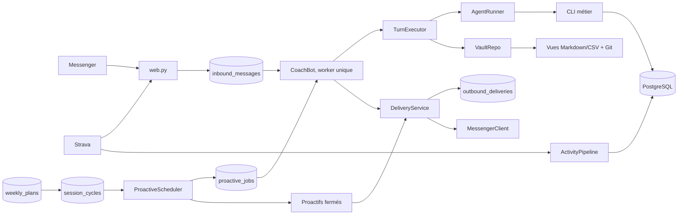

# Redline Messenger

Service Messenger qui lit Strava, porte ses faits dans PostgreSQL, tient un vault Git
et s'exprime par un agent Codex ou Claude Code.

Ce document décrit aussi un déploiement de référence : les chemins, les noms d'unités
systemd et l'utilisateur `ubuntu` sont ceux d'un VPS réel, à adapter avant d'installer.
La vue d'ensemble, le chemin d'un message et les invariants décrivent le système tel quel.

La politique de coaching ne vit pas dans le service. Elle appartient à `CLAUDE.md`,
aux notes propriétaires du vault et aux schémas de `scripts/model/`. Le service
authentifie, ordonnance, persiste et livre.

## Vue d'ensemble



Les webhooks répondent rapidement. Un worker unique sérialise ensuite les messages,
commandes et initiatives afin que deux tours ne partagent jamais une session agent,
un worktree ou une livraison.

### Chemin d'un message Messenger

1. `web.py` vérifie la signature Meta et le PSID autorisé.
2. Le message est inséré dans `inbound_messages` avec l'état `pending`.
3. `CoachBot` regroupe les textos rapprochés. Quelques salutations et remerciements
   exacts sont triés localement en N0 ; toute autre formulation passe au classifieur
   (Luna low, 10 s, sans repli : un échec vaut N1). Un paquet borné de faits
   PostgreSQL est injecté selon le niveau obtenu. Le mot du matin reçoit le même
   contexte.
4. `VaultRepo.sync()` intègre uniquement les commits distants qui ne touchent pas le
   runtime. Un changement de code attend un déploiement.
5. `TurnExecutor` crée un `turn_id`, lance l'agent (un seul appel de modèle) puis
   applique toutes les commandes PostgreSQL du tour dans une transaction, avec trois
   nouvelles tentatives sur une panne transitoire. Un fichier de code ou une projection
   modifiés pendant le tour sont restaurés sans perdre les notes ni les commandes.
6. Les semaines requises sont relues et validées ; les notes du vault sont committées
   localement, sans réseau.
7. `CoachBot` décide si une prescription canonique accompagne la prose.
8. `DeliveryService` enregistre l'enveloppe complète (texte, boutons) dans
   `outbound_deliveries.payload`, puis livre via `MessengerClient`. Une reprise renvoie
   cette enveloppe, jamais un nouveau tour de modèle.
9. Le message entrant passe à `done`. Un crash avant cette étape le rend récupérable
   au démarrage suivant.
10. Après la livraison seulement, le worker régénère les vues, committe et pousse
    (`VaultRepo.publish`) puis synchronise le dépôt.

Une photo ou un document suit une frontière différente : le webhook ne conserve que
l'URL Meta le temps de la reprise, le worker télécharge un JPEG/PNG/WebP/PDF/TXT/CSV
borné dans `server/attachments/` (0600), puis lance un tour agent en lecture seule.
Le brut est supprimé dans un `finally` et l'URL est vidée de PostgreSQL. Le coach rend
des observations et d'éventuels faits candidats ; seule la confirmation suivante,
dans un tour normal, peut les écrire. Vidéo et audio sont refusés sans analyse.

Une erreur agent ou une persistance refusée abandonne les commandes préparées et
restaure le worktree. Les faits déjà committés dans PostgreSQL ne sont jamais simulés
comme annulés parce qu'une projection ou un push Git a échoué.

## Propriétaires du code

| Module | Responsabilité |
|---|---|
| `app.py` | composition, vérifications de démarrage et cycle de vie |
| `config.py` | lecture unique du `.env` et de l'environnement au démarrage |
| `clock.py` | horloge civile, au fuseau de `redline.toml` (`[athlete] timezone`) ; le stockage reste en UTC |
| `events.py` | événements d'exploitation structurés, une ligne JSON par étape |
| `web.py` | routes HTTP, authentification et normalisation des entrées |
| `bot.py` | orchestration conversationnelle et politique de livraison |
| `work_queue.py` | sérialisation, priorités et debounce des entrées |
| `turns.py` | transaction d'un tour agent et abandon fail-closed |
| `plans.py` | lecture et rendu purs du programme hebdomadaire |
| `vault.py` | accès domaine, projections et frontière Git |
| `agent.py` | contrats communs des fournisseurs, registre du travail en cours, reprise de session |
| `agent_factory.py` | choix du moteur au démarrage |
| `routing.py` | profils N0–N3, triage, deep, proactifs et replis communs |
| `codex.py` | threads du SDK Codex |
| `claude.py` | processus Claude Code CLI |
| `state.py` | contrats du stockage runtime |
| `postgres_state.py` | sessions, inbox, jobs, quotas et marqueurs durables |
| `relationship.py` | mémoire relationnelle compacte injectée au tour |
| `proactive.py` | matérialisation et sélection des initiatives |
| `proactive_messages.py` | rendu des initiatives fermées, sans agent |
| `activity_pipeline.py` | capture Strava puis enrichissements D-/WBGT rejouables |
| `attachments.py` | téléchargement Meta borné, validation et suppression du brut |
| `race_countdown.py` | compilation d'une date de course en jalons persistants |
| `triage_rules.py` | triage haute précision local, avant le repli modèle |
| `delivery.py` | enveloppes ordonnées, journal réseau et succès partiels |
| `messenger.py` | transport Meta et résultats de livraison |
| `textutils.py` | découpage en rafale, partagé par l'agent et le transport |
| `outbox.py` | cycle de vie des images et sidecars |
| `strength_artifact.py` | carte renfo rendue depuis la prescription typée |
| `prompts.py` | choix des textes injectés à chaque tour et des workflows proactifs |
| `scripts/coach/fr/` | les mots du coach et du service : `prompts/*.md`, `messages.py` (notes), `replies.py` (limites), `initiatives.py`, `notebook.py`, `session_labels.py`, `calendar.py` |
| `strength.py`, `page/` | capacités opaques et page de renforcement |
| `scripts/storage/repository.py` | transactions et faits opérationnels |
| `scripts/storage/projector.py` | vues Obsidian régénérables |

Pour modifier un comportement :

- ton, méthode ou règle de coaching : `CLAUDE.md` ou son propriétaire dans le vault ;
- texte injecté par le service : `scripts/coach/fr/` ; quand il est injecté : `prompts.py` ;
- décision d'envoi : `bot.py` ;
- forme du programme : `scripts/model/weekly_plan.py` ;
- rendu Messenger du programme : `plans.py` ;
- persistance d'un fait : `scripts/storage/repository.py` ;
- calendrier d'une initiative : `proactive.py`.

## Invariants

- PostgreSQL est obligatoire et canonique. Markdown et CSV sont des projections.
- Une commande agent porte toujours `REDLINE_TURN_ID`. Le service applique ou
  abandonne toutes les commandes de ce tour ensemble.
- Les faits sont inconditionnels. Un défaut de programme retient la prescription,
  pas les observations déjà enregistrées.
- Une semaine absente ou invalide retire toute prescription : le coach est prévenu de
  n'en donner aucune, aucun bloc canonique ne part, et une demande de programme reçoit
  une ligne précise. La prose, dont une précaution de sécurité, part toujours.
- Une semaine périmée laisse parler le coach mais ne prescrit rien.
- La péremption compare les activités d'effort non rattachées au watermark PostgreSQL
  de la révision ; elle ne dépend pas d'une égalité entre versions d'empreinte.
- Une précondition datée retient seulement les séances nommées dans `holds`. Les
  anciennes révisions sans `holds` retiennent toute la semaine par prudence.
- Le programme envoyé est rendu depuis la révision persistée, jamais depuis la prose
  libre du modèle.
- Une demande explicite rend seulement sa portée (`today`, `next`, `remaining` ou
  `full`) et peut être répétée ; une révision spontanée ne rend que son delta.
- Une mesure brute ne porte jamais sa cause. Les expositions volontaires, prescrites
  ou spontanées vivent séparément et ne comptent qu'une fois confirmées.
- Le plan porte l'intention (`planned` ou `cancelled`). Le réalisé est projeté depuis
  `session_cycles` et n'écrit jamais `done` dans une nouvelle révision.
- Une activité Strava capturée reste durable même si le stream ou la météo échoue.
  Chaque enrichissement a son propre état et son propre compteur de tentative.
- La modulation renfo est écrite dans le plan : sa livraison ne la redécide pas.
- Une tâche proactive n'est acquittée qu'après une livraison textuelle effective.
  Une livraison partielle n'est pas rejouée, afin de ne pas dupliquer les fragments
  déjà reçus.
- Une pièce jointe sortante refusée est mise en quarantaine dans `outbox/failed/`. Elle n'est
  pas rejouée avec le texte déjà livré.
- Une pièce jointe entrante n'a jamais de droit d'écriture : URL et brut sont
  éphémères, son contenu est traité comme donnée non fiable, et toute mémorisation
  attend une confirmation textuelle ultérieure.
- Une enveloppe `sending` retrouvée après crash n'est pas rejouée aveuglément : Meta
  n'offrant pas de clé d'idempotence, le service choisit l'at-most-once et signale
  l'ambiguïté dans les journaux. Une enveloppe `failed` sans fragment livré peut être
  retentée. `408`, `425`, `429` et `5xx` sont repris par le transport.
- Silence, cellules déclaratives, séance manquée, digestion,
  matériel et message opérateur ne réveillent pas l'agent ; un détail illisible
  passe le job en `failed` au lieu d'appeler le modèle.
- Une initiative rendue par l'agent répond au schéma `{send, text}` : `send=false` est un
  silence voulu, jamais déduit de la prose. Elle ne montre pas d'indicateur de saisie.
- Les jobs `running` et messages entrants `pending` sont repris au démarrage. Un
  entrant direct échoué reste `pending` et est retenté après 30 s, 5 min puis toutes les
  30 min (ou à l'heure de retour annoncée par le fournisseur), 48 fois au plus, puis
  reste `pending` pour le démarrage suivant. Dès qu'une reprise doit attendre plus de
  deux minutes, une seule phrase (au plus une toutes les deux heures) prévient l'athlète
  que la réponse arrive ; une réponse tardive reçoit l'âge du message pour ne pas le
  traiter comme actuel.
- Les messages proactifs sont journalisés par le service après livraison. L'agent ne
  possède pas cette trace.
- Codex tourne sans sandbox Linux dans le service : bubblewrap n'est pas une
  dépendance de production. Les garde-fous sont applicatifs et stables : utilisateur
  Unix non privilégié, approbations interactives refusées, environnement agent purgé,
  CLI métier root-owned, transactions PostgreSQL par `turn_id`, contrôle des chemins
  runtime et retour Git en lecture seule. `SANDBOX_NEEDS` contient les seules valeurs
  d'environnement nécessaires aux CLI métier.
- Le runtime n'est jamais mis à jour depuis un tour. `VaultRepo.sync()` refuse tout
  commit entrant touchant `server/`, `scripts/`, `migrations/`, les hooks, la CI, les
  dépendances ou les assets lus au démarrage.
- **« Runtime » = le service tourne différemment après ce commit** (choix de design,
  2026-08-21). Ni `coaching/exercises/*.md` — des données relues à chaque appel de
  `chart-strength.py`, et que le coach édite lui-même — ni `server/tests/` n'en sont :
  aucun ne demande de redémarrage, et un test poussé avec du code est de toute façon
  retenu par le code. Les y avoir laissés faisait geler la synchronisation du vault sur
  une écriture parfaitement légitime.
- **Les diagnostics internes restent dans les journaux d'exploitation.** Aucun texte
  d'adaptateur (watchdog, tour, moteur) n'est montré à l'athlète : chaque classe d'échec a
  une phrase à lui, définie une fois dans `bot.py`. Si la persistance d'un tour réactif
  est refusée, sa prose part avec une ligne qui nomme ce qui n'a pas été enregistré
  (« ta séance », « ton état du jour »…) ; aucun programme n'accompagne ce tour. Un échec
  de push après sauvegarde valide reste un incident d'exploitation. Seule une donnée réellement
  inutilisable ou expirée — typiquement une pièce jointe que Meta ne rend plus — peut
  demander d'être renvoyée. Un bilan invalide reste ouvert et se reprend automatiquement ;
  il n'est ni acquitté ni annoncé comme incident.

## Installation locale

Python 3.12 est requis.

```bash
python3.12 -m venv .venv
.venv/bin/pip install -r server/requirements.txt -r server/requirements-dev.txt
cp server/.env.example server/.env
```

Créer ou migrer PostgreSQL avec le rôle de migration, puis lancer depuis la racine :

```bash
DATABASE_URL='postgresql+psycopg://…' alembic upgrade head
PYTHONPATH="$PWD:$PWD/server" .venv/bin/python -m redline
```

Le démarrage refuse :

- Python antérieur à 3.12 ;
- configuration Messenger incomplète ;
- fournisseur agent inconnu ;
- valeur numérique, booléenne, horaire, effort ou route invalide (notamment Sol Max) ;
- PostgreSQL indisponible.

`server/.env.example` est la référence exhaustive. En local, `server/.env` est toléré ;
en production, le fichier réel vit hors du checkout dans
`/etc/redline/runtime/coach-messenger.env`, lisible par le seul utilisateur du service.
Les variables `AGENT_*` sont les
seules variables de modèle, effort et timeout. `CLAUDE_CODE_OAUTH_TOKEN` reste propre
à l'authentification du fournisseur Claude. Le provider Claude exige une CLI 2.1.197+
et utilise directement `--effort` et `--fork-session`.

## Endpoints

| Méthode | Route | Usage |
|---|---|---|
| `GET` | `/webhook` | challenge Meta |
| `POST` | `/webhook` | événements Messenger signés |
| `GET/POST` | `/strava-webhook/<secret>` | abonnement, créations et titres renommés filtrés |
| `GET` | `/s` | coquille générique de la page de renforcement |
| `POST` | `/strength-session` | résolution d'une capacité opaque, sans cache HTTP |
| `POST` | `/strength-report` | rapport par capacité, claim, quota et faits atomiques |
| `GET` | `/health` | liveness, commit déployé, empreinte `runtime_tree` et uptime |
| `GET` | `/ready` | worker actif, PostgreSQL joignable et schéma à la tête Alembic (local seulement) |

Tout corps de requête est plafonné à 1 Mo par le service et par Caddy ; les routes du
carnet et du renfo descendent plus bas. Les handshakes `hub.*` comparent leur jeton en
temps constant et renvoient le challenge en texte ou en JSON, jamais en HTML.
`MESSENGER_VERIFY_TOKEN`, `STRAVA_VERIFY_TOKEN` et `STRAVA_WEBHOOK_SECRET` font au
moins 32 caractères, sinon le service refuse de démarrer. Caddy ajoute HSTS et réserve
`/ready` au VPS, puisqu'il interroge PostgreSQL à chaque appel.

### Abonnement Strava

Strava ne signe pas ses événements et l'id d'athlète est public : la route n'est
authentifiée que par le segment `STRAVA_WEBHOOK_SECRET` de l'URL de callback. Une URL
fausse répond 404. Changer ce secret impose de recréer l'abonnement, après le
redémarrage du service, car Strava valide l'URL immédiatement :

```bash
set -a; . /etc/redline/runtime/coach-messenger.env; set +a
/home/ubuntu/.venvs/redline-current/bin/python server/strava-subscription.py renew
```

`status` rend 0 si l'unique abonnement pointe vers l'URL attendue. Aucun des deux
modes n'affiche l'URL ni un secret.

Le fragment ne transporte plus la séance mais un jeton aléatoire de 192 bits. Le
service n'en stocke que le SHA-256, avec le snapshot exact et immuable livré sous la
carte, puis le résout sans cache HTTP. Le lien expire après sept jours et peut être
révoqué irréversiblement. Après une première ouverture réussie, le navigateur garde
le snapshot dans `localStorage` pour reprendre la séance hors ligne ; une expiration
ou une révocation confirmée par le serveur prime sur ce cache. Les anciens fragments
ne sont pas interprétés : un lien doit être une capacité opaque connue de PostgreSQL.

Claim, quota journalier, séance et débrief, message entrant durable, audit et demande
de projection sont écrits dans une transaction unique. La page conserve la date
civile du premier exercice et réessaie avec un backoff borné. Une panne de base rend
`503` sans consommer le claim ; un crash après le commit laisse le message `pending`,
repris au prochain démarrage. Les réponses distinguent `accepted` (`201`),
`duplicate` (`200`), `quota` (`429`), lien expiré (`410`) et rapport invalide (`400`).

La page sauvegarde aussi les brouillons, les chronos et la dernière validation
annulable. Une reprise de temps de travail interrompu demande confirmation ; un
enchaînement automatique reste limité aux séries de l'exercice courant et ne lance
aucun travail lorsque la page est masquée. Les signaux de fin de travail et de repos
ont des motifs distincts, une intensité persistée et un bouton de test.

Les séries validées avant un arrêt restent journalisées avec leur position et leur
côté, un état `partial`, leur nombre et la remarque propre à l'exercice. Les exercices
retirés par le garde-fou restent consultables sans pouvoir être exécutés ou évalués.
La prescription exacte est conservée avec le rapport : la préparation compare la
dernière prescription rapportée du même type, séparément des performances réalisées.
Les historiques sans snapshot ne donnent lieu à aucune comparaison reconstruite.
Le rapport est figé dès l'envoi et les reprises réseau réutilisent le même contenu ;
après réception, une correction se transmet explicitement dans Messenger.

Un rapport de renfo complète le cycle prévu lorsqu'une seule séance et un seul rapport
partagent la date et le type A/B, sans recopier le rapport au registre ni inventer une
heure de fin. Ce rapprochement est aussi exécuté avant la détection des séances manquées
pour les rapports historiques. Une correspondance ambiguë ne complète aucun cycle et
ne justifie aucune relance d'absence. La cause d'une relance est revérifiée à l'envoi.

## Sessions et commandes

Le triage classe chaque message de N0 à N3. Il choisit le volume de lecture et les
indicateurs de ton, puis la même décision sélectionne un profil de modèle et d'effort.
Seules quelques salutations exactes sont reconnues localement ; tout le reste passe au
classifieur, qui ne dispose ni de shell ni de documentation projet. Un triage en échec
ou hors délai vaut N1 sans escalade d'effort. Une émotion exprimée n'impose ni phrase
d'accueil ni question : la dernière demande fixe la posture, et une demande concrète se
traite avec les contrôles habituels. Le niveau règle ce qui se lit, pas la longueur
envoyée : une correction vérifiée en N3 peut tenir en une phrase, et un fait simple
contesté se relit chez son propriétaire, pas dans la littérature. Une clôture sociale
n'ouvre pas un nouveau sujet ; en N0, une observation du jour ne force ni prescription
ni question, alors qu'un contrôle bloquant voyage entier à tous les niveaux. Les phrases d'attente statiques ne promettent ni délai
ni accès à une source ; les phrases contextuelles suivent la même consigne de triage.
La configuration est commune à Claude et Codex (`redline/routing.py`). Le fournisseur
par défaut est Codex, avec les identifiants GPT-6 Luna et Sol :

La réponse produite par le coach part directement après les portes déterministes du
service : persistance réussie, plan PostgreSQL valide quand une prescription est demandée,
contrôles datés, péremption et rendu canonique. Il n'existe aucun second appel de modèle
avant le transport, y compris quand le tour a appliqué des commandes. Une semaine
illisible n'efface pas la réponse : elle retire seulement la prescription et ajoute une
ligne précise. Un tour terminé sans texte reçoit une seule relance dans la même session. Ce second jugement retenait des réponses correctes quand il lui
manquait une preuve ou quand il expirait, ajoutait de la latence et cassait la continuité
de la conversation sans pouvoir garantir la justesse médicale.

Le jugement sémantique probabiliste vit dans le paquet `evaluation/`, hors de `redline/`,
et n'est appelé que par `evaluate-coaching.py`, banc d'évaluation explicite. Il sert à confronter des cas rouges et à
améliorer les instructions du coach ; son indisponibilité ou son verdict ne peut jamais
retenir une conversation Messenger. Les limites de coaching (diagnostic, médicaments,
tests douloureux, scores inférés et identité) appartiennent aux instructions du coach et
aux scénarios d'évaluation. Les protections sur les écritures et le programme restent du
code déterministe.

`server/evaluate-coaching.py --output /tmp/coaching-evaluation.json` produit des réponses
fictives avec les profils du fournisseur de `AGENT_PROVIDER` (Claude en production : la
route du scénario, juge sur le profil N2), sans outil, mémoire persistante ni envoi.
`ClaudeCodeRunner.one_shot` lance `claude -p` dans un dossier vide, donc sans `CLAUDE.md`,
comme le banc Codex ; `evaluation/runner.py` borne les modèles payables.
Les fixtures `server/tests/fixtures/coaching-scenarios.json` portent 36 scénarios, leur
contexte, posture, réponse illustrative et critères d'acceptation ; ceux qui naissent d'une
correction réelle nomment leur origine (`origin`), vérifiée par `test_coaching_scenarios.py`. Le registre `coaching/corrections-replay.json` du vault donne à chaque entrée de
`coaching/corrections.md` son mode de rejeu ; `vault-check.py` signale celles qui attendent
encore un scénario (`a-rejouer`). Les routes sont imposées
par les fixtures et les lectures remplacées par des faits fictifs : ce banc évalue la
rédaction, pas le routage réel ni les effets des outils. La relecture humaine reste nécessaire ;
les compteurs de questions et paragraphes ne mesurent pas le naturel. Avec
`--fixtures server/tests/fixtures/coaching-review-cases.json`, le même outil teste treize
verdicts attendus et échoue sur un désaccord. Ces appels explicites sont payants, hors CI ;
les tests déterministes couvrent séparément mémoire, échecs d'outils et transport.

Le banc échoue aussi sur une réponse vide, un dépassement des budgets de forme ou
un refus du juge sur une réponse générée. Le drapeau `emotional` des fixtures commande
l'injection émotionnelle ; les bulles suivent le découpage partagé du transport.

`server/evaluate-conversation.py` complète ce banc avec douze situations et vingt et un
tours. Il réinjecte les réponses produites au tour suivant, propose une variante
`contextual` limitée à l'évaluation, et compare deux fichiers de résultats hors ligne
avec une grille de lecture à l'aveugle. `--dry-run` exporte le contenu sans appel de
modèle ; `--only` et `--repeat` bornent l'expérience. Il n'exécute ni triage réel,
ni outil métier, ni envoi Messenger. Les compteurs décrivent la forme, sans désigner
automatiquement une réponse plus naturelle ; la procédure, ses limites et la grille
de lecture restent dans le code du banc (`evaluation/`) et ses fixtures.

| Route | Codex | Repli Codex | Claude | Repli Claude | Session |
|---|---|---|---|---|---|
| triage | GPT-6 Luna / low | — | Haiku 5.5 / low | — | isolée, lecture seule |
| N0 | GPT-6 Luna / medium | GPT-6 Luna / high | Sonnet / low | Haiku 5.5 / low | continue |
| N1 | GPT-6 Luna / high | GPT-6 Luna / high | Sonnet / low | Opus / medium | continue |
| N2 | GPT-6 Sol / medium | GPT-6 Luna / max | Sonnet / high | Opus / high | continue |
| N3 | GPT-6 Sol / high | GPT-6 Luna / max | Opus / medium | Sonnet / high | continue |
| `/deep` | GPT-6 Sol / high | GPT-6 Luna / max | Opus / high | Sonnet / high | fork éphémère |
| proactif lourd | GPT-6 Sol / high | GPT-6 Luna / max | Opus / high | Sonnet / high | isolée |

Côté Claude, Haiku est épinglé sur `claude-haiku-5-5` : l'alias `haiku` du CLI stable
résout encore Haiku 4.5. Sonnet et Opus suivent leur alias, que le prévol nocturne affiche.
N0 à N2 partagent Sonnet pour que la session continue garde son cache, propre à chaque
modèle, et chaque repli change de modèle pour ne pas retomber sur le même quota.

Le triage n'a aucun repli : un échec ou un dépassement de `TRIAGE_TIMEOUT` (10 s)
vaut N1. Chaque autre ligne possède un seul fallback explicite, réservé aux échecs de prévol ou de
quota avant travail utile. Dès qu'un tour a commencé, une panne en vol, `/cancel` ou le
watchdog est terminal : aucun autre modèle ne recommence le travail et l'entrant n'est
pas rejoué. Le fallback de prévol reste transactionnel. En N1, il réessaie Luna High une seule
fois avant tout travail utile, sans augmenter le coût du modèle. Les identifiants Codex par
défaut sont `gpt-6-luna` et `gpt-6-sol`, y compris pour les surcharges et replis. Ce sont les
noms de modèle actuellement publiés par OpenAI ; ils ne signifient pas « Luna/Sol, quelle que
soit la génération » et ne basculeront pas automatiquement vers une future génération. Les efforts
et watchdogs restent optimisés pour le coût, même au prix de la latence. Sol Max
(Sol avec effort `max` ou `ultra`) est refusé au démarrage, y compris pour un fallback.
La fenêtre proactive commence à `PROACTIVE_ACTIVE_START` et court jusqu'à minuit : elle
n'a pas de fin configurable, et aucune durée de travail n'est confrontée à une fin de
plage.
Les variables `AGENT_<ROUTE>_MODEL`, `_EFFORT`, `_FALLBACK_MODEL` et
`_FALLBACK_EFFORT` permettent de surcharger chaque ligne ; les anciennes variables
plates `AGENT_MODEL*`/`AGENT_EFFORT*` ne sont plus lues.

La session ordinaire expire selon `SESSION_TTL_HOURS` et reste liée à son fournisseur et
à l'empreinte de ses instructions (`prompts.instruction_digest`) : le prompt de style et
le contenu des propriétaires lus sur disque, `CLAUDE.md` et `AGENTS.md`. Un changement
de l'un d'eux abandonne le fil à son prochain tour ; un commit de notes, de journal ou
de hot-cache ne le fait pas. Changer de route ne change pas cette règle : le modèle et
l'effort sont transmis à chaque tour, tandis que `/deep` et les bilans lourds gardent
leur contexte éphémère ou isolé.

Commandes disponibles :

- `/help` ;
- `/status` ;
- `/cancel` ;
- `/renfo` pour renvoyer la carte prescrite aujourd'hui ;
- `/clear` ;
- `/deep <question>` pour un fork lourd ponctuel.

`/status` et `/cancel` contournent le worker afin de rester disponibles pendant un tour
long. Les autres commandes restent sérialisées. `/clear` solde explicitement les
messages tamponnés qu'il abandonne. L'indicateur de saisie s'allume dès la
réception, avant le triage. Après 75 secondes, une seule phrase d'attente part, quel que
soit le niveau ; elle est mémorisée dans la conversation comme un vrai message. Après
90 secondes, un tour N2/N3 cesse seulement de rafraîchir l'indicateur.

## Programme hebdomadaire

Le programme appartient à PostgreSQL et ses révisions sont append-only.

```bash
python3 scripts/week-plan.py show --week 2026-W33
python3 scripts/week-plan.py check --week 2026-W33
python3 scripts/week-plan.py revise --week 2026-W33 < revision.json
```

Codes de `check` et `show` :

- `0` : prescriptible ;
- `1` : absent ou invalide ;
- `2` : valide, mais une précondition datée attend une réponse ;
- `3` : périmé, à réviser avant de prescrire.

Le bloc canonique est envoyé uniquement si ce qu'il reste à faire a changé, si l'athlète
le demande, ou si une dette de livraison existe. Le numéro de révision seul ne suffit
pas : une révision peut ne consigner que du passé.

La relecture de `revise`, `preview` et d'un changement préparé affiche l'écart de chaque
course à venir à la plus longue des 30 jours précédents. Elle est informative et ne bloque
rien : aucun pourcentage fixe ne borne la sortie longue. Les règles en vigueur, une
ligne chacune, leurs seuils et les natures de transition vivent dans `rulebook.toml` à la
racine du vault ; sans lui, le moteur applique `rulebook.default.toml`, qu'un vault
remplace en entier, jamais en partie. `scripts/model/rulebook.py` le valide (le service
refuse de démarrer sur un règlement non conforme) et le relit s'il change. Le paquet de
contexte l'injecte à chaque tour N1+ et au bilan.

Une prescription de renforcement active est résolue contre les vraies fiches de séance
pendant la validation : variante, retraits et garde-fou inconnus bloquent la révision
avant activation. Le mot du matin arme ensuite une tâche durable `strength_card`,
identifiée par semaine, révision, séance et date. Cette tâche et `/renfo` rendent la
carte directement depuis le plan typé ; elles ne construisent aucun prompt et
n'appellent jamais l'agent. Chaque tick rematérialise la dette du jour avec la même
identité, ce qui récupère aussi un mot du matin manqué ou un redémarrage. La livraison
reprend l'idempotence de l'enveloppe sortante.

## Proactivité et livraison

Le scheduler matérialise des jobs à identifiant stable : débrief Strava, mot du matin,
revue hebdomadaire, recul mensuel, reprise après silence et relance de cellule.
Une séance du plan peut porter un `start_time` local `HH:MM` ; s'il est absent, aucune
heure n'est inventée. Le jeu de calibration (prédiction de la veille, J+1 en réponses
rapides) est arrêté depuis le 2026-10-09 ; ses tables restent lisibles.

Avant le tour du bilan hebdomadaire, le service calcule un dossier
(`scripts/weekly_dossier.py`) avec les mêmes fonctions que les CLI : semaine close,
trajectoire de la sortie longue et stagnation, signaux, prédictions échues,
échéances échues, capacités. Il l'injecte avec le paquet N2 ; un calcul en
échec le remplace par une ligne qui renvoie aux CLI, sans retenir le bilan. Le projecteur
crée le journal de la semaine courante et de la suivante quand un programme existe.

La période d'un bilan appartient à sa clé durable : `weekly:2026-W34` clôt W34 et
prépare W35, même si un retry ne repart que le lundi. Une initiative en échec est
réclamée trois fois au plus (5, 15 puis 45 min d'écart, ou l'heure de retour annoncée
par le fournisseur), toujours avec une expiration ; au-delà elle passe `failed` avec sa
cause dans `last_error`, distincte d'un envoi réussi. Un texte déjà rédigé n'est jamais
régénéré par ces reprises. Du lundi au samedi, une semaine en cours sans programme
valide arme un job `weekly-repair:<semaine>` isolé, qui doit laisser une révision
valide. Après une réparation opérateur, un job terminé ou en échec se rouvre sans SQL
ad hoc, et cette commande reste volontairement hors du sandbox du coach :

```bash
scripts/proactive-job.py status --job-key weekly:2026-W34
scripts/proactive-job.py reopen --job-key weekly:2026-W34
```

Les commandes opérateur s'exécutent depuis la racine, avec l'environnement du service
(`DATABASE_URL` et le python du venv) : sur le déploiement de référence, un wrapper SSH
du poste local les porte ; cette édition livre les CLIs, pas le wrapper.

Un texte rédigé hors du service (un bilan fait depuis le Mac) part par la même chaîne,
sans tour de modèle, avec `operator-message.py` : job fermé `operator_message`,
prioritaire, périmé après 6 h, idempotent par sa clé, tracé en mémoire de conversation.
Commande opérateur, hors du sandbox du coach :

```bash
scripts/operator-message.py --key bilan-w39 --text "…"
```

`session_cycles` donne à chaque `plan_id + logical_key` une identité stable à travers les
révisions append-only. Une nouvelle révision resynchronise le cycle et conserve l'état
si les champs utiles n'ont pas changé ; une séance annulée ou retirée perd son retour
digestif en attente. `scripts/session-cycle.py` enregistre un départ déclaré
facultatif et un appariement explicite.
L'observation Strava porte l'heure réelle : elle remplace l'heure effective, conserve
le départ déclaré comme trace et ferme rétroactivement la séance si « j'y vais » a été
oublié. Une ambiguïté de date et de type reste non appariée jusqu'au choix de l'athlète.
Le webhook réveille le scheduler, qui capture aussitôt le distillat et ses tours dans
`strava_activity_intakes` : la sortie entre au registre et le carnet peut demander ses
ressentis avant le débrief. Le débrief part au premier signal que l'athlète a fini : titre
renommé dans Strava (événement `update`, titre et description s'enregistrent ensemble),
ressentis complets dans le carnet, ou message Messenger, dont la réponse porte alors le
débrief au lieu de le repousser de huit minutes. Sinon il part après
`STRAVA_DEBRIEF_DELAY`. Le service injecte au débrief un instantané borné de ce fait
persistant, titre et description relus juste avant, ressentis déjà donnés compris : le
modèle ne refait pas l'appel Strava et un redémarrage relit la capture avant tout réseau.
Une capture ratée se reprend à la minute pendant trois minutes, puis toutes les 5 min.

La même matérialisation transforme les autres faits typés en initiatives idempotentes :
séance manquée, signal quotidien, pré-mortem de course, suivi digestif, usure du
matériel, correction spontanée et contradiction d'une hausse de charge. Une correction
s'annonce dans les 7 jours qui suivent son enregistrement, ou jamais : l'annonce expire
et `fact-read.py corrections` le dit, avec le nombre de récidives tiré du journal d'audit.
`fact-write.py correction` exige `--entry`, le titre d'une entrée déjà écrite dans
`coaching/corrections.md`. Seules les
échéances `race` déclenchent un scénario ; une `availability` interdit mécaniquement une
séance exigeante sur sa plage. Rappel pré-séance, repère mental minuté, alerte météo et
rendez-vous médical ont été retirés le 2026-09-28 (migration `0039`).

Les derniers échanges livrés et les questions ouvertes vivent dans
`conversation_messages` et `conversation_questions`. Une question n'est ouverte que par
une commande `question.ask` appliquée dont le texte figure dans le message livré ; la
prose seule n'en crée aucune. Une question restée ouverte quatorze jours sans examen est
fermée en `expired` pendant la maintenance. Cette mémoire datée est injectée
à chaque tour : huit échanges avec leurs identifiants, vingt questions au maximum et
les sujets conservés. Les lignes de service (attente, panne, limite) restent en base
mais ne comptent pas parmi les huit. En N2 et N3, le paquet métier porte déjà les fils
ouverts : le souvenir ne les rend pas une seconde fois. Les douze dernières questions closes restent visibles avec leur
réponse ou leur limite, pour éviter de les reposer. Les textes longs signalent leur
abrègement et gardent leur fin. `fact-read.py conversation --query <sujet>` recherche
les anciens échanges en français et donne le message daté avec ses voisins. Le service
lie le tour à son PSID dans `turn_scopes` ; la CLI refuse un tour absent ou expiré, sans
exposer l'identifiant Messenger au shell. `knowledge-search.py --query <sujet>` repère les fiches
théoriques ; son résultat est un index à ouvrir, pas une preuve déjà lue.
`fact-read.py questions --limit 1000` permet de retrouver les questions plus anciennes.
Un mot commun, un chiffre, un oui ou une réponse Messenger ne clôt aucune question.
Le coach examine explicitement la réponse avec `fact-write.py question`, qui porte les
identifiants de question et de message, une note et un état : `open` pour une réponse
partielle, `answered` pour une réponse suffisante, `deferred` pour une reprise ultérieure
et `expired` pour un sujet fermé. Une date de reprise n'est enregistrée que si convenue.
La note conserve ce qui a été compris et ce qui manque ; aucune réponse partielle ne
devient automatiquement une réponse complète. La revue est transactionnelle et exige
un message ultérieur de la même personne. Une correction
enregistrée est rapprochée du texte entrant par recouvrement lexical et n'est poussée
spontanément qu'une fois.

Les questions du modèle sont déclarées par `fact-write.py ask --text ...`, avec les
seules clés `--cell` demandées. Leur texte exact doit avoir été livré avant de créer
la question et ses marqueurs ; une simple réponse ne marque plus tous les ressentis
comme demandés. Le suivi est réservé à une information attendue : une question sociale
ou rhétorique ne se déclare pas. Un rendu fermé n'a pas de tour ; il nomme lui-même la
question qu'il attend (`ClosedProactive.question`), créée après livraison confirmée sous
la même condition de présence dans le texte parti. Avant l'envoi, le service renonce si
cette question exacte est encore ouverte ou reportée, ou soldée depuis moins de trois
jours. La prise de nouvelles après un silence et le message opérateur n'ouvrent aucune
question.
Les informations manquantes ne forcent pas un questionnaire et ne sont pas injectées
dans un tour N0 ou émotionnel. Une relance différée relit les cellules encore inconnues,
écarte celles déjà demandées et n'en demande qu'une, en priorité la douleur d'effort.
Le paquet de contexte distingue une section vide d'une lecture PostgreSQL échouée,
et conserve les autres sections disponibles. Il date la lecture, identifie les états
quotidiens historiques et signale qu'une nuit ancienne ou de date incohérente ne
décrit pas la nuit du jour. Mesures objectives et ressenti déclaré restent distincts :
une contradiction demande une vérification des sources, jamais une fusion implicite.

Les initiatives revérifient les entrants en attente, le tour réactif en cours et le
délai de silence de huit minutes avant leur préparation puis avant l'envoi. Une reprise
de conversation remet le job en attente sans détruire son texte : l'enveloppe préparée
est conservée et livrée plus tard sans nouveau tour de modèle, sauf si la révision du
programme a changé entre-temps. Les initiatives légères travaillent dans un fork de la
conversation, les bilans lourds dans une session isolée ; aucune n'efface la session
conversationnelle. Les faits déjà validés restent enregistrés. Les cartes automatiques et messages composés localement suivent aussi
ce contrôle d'activité. Il porte sur les messages reçus, pas sur la saisie d'un brouillon.
Un envoi partiel ne mémorise que les fragments confirmés, ne marque pas les mesures
non demandées et n'est pas rejoué intégralement. Un envoi déjà engagé dans la Send API
ne peut pas être rappelé.

Un swipe-reply Messenger reste une relation explicite de bout en bout. Le webhook garde
`message.reply_to.mid`, tandis que chaque texto accepté par la Send API garde son MID et
son morceau exact dans `messenger_message_refs`. Au tour suivant, le message cité est
injecté comme contexte ciblé sans modifier le texte brut utilisé par le triage. Une
référence antérieure à cette rétention est signalée comme inconnue : elle n'est jamais
reconstruite au jugé.

Les prédictions de décision ont une probabilité, une échéance, un verdict et un score de
Brier. Toute hausse concrète d'une cible ou d'un plafond dans une révision ultérieure
exige une prédiction `direction=increase` déjà challengée ; cette autorisation est
consommée par une seule révision. Le refus est donc transactionnel, pas une consigne que
le modèle peut oublier.

```bash
python3 scripts/session-cycle.py pending --week 2026-W34
python3 scripts/session-cycle.py reconcile-strava --days 30
python3 scripts/fact-read.py predictions
python3 scripts/fact-read.py gear
```

Cycle normal : `pending` -> `running` -> `done`. Une erreur avant livraison remet le
job en attente avec une expiration bornée. Au démarrage, les jobs restés `running`
redeviennent `pending`.

La détection et le rythme d'envoi ne journalisent pas un envoi. Il n'existe aucun
plafond journalier d'initiatives : chaque job garde sa propre pertinence via
`expires_at`. Après livraison seulement, le service mémorise l'heure du dernier envoi,
termine le job dans une même transaction, puis ajoute `proactive_messages`.

## Projections et Git

Chaque mutation de fait marque `projection_states` comme sale. Le projecteur régénère
toutes les vues sous verrou PostgreSQL, exécute les générateurs statiques, puis acquitte
l'état seulement si l'ensemble a réussi.

Git versionne ces vues et les notes du vault. Un tour ne fait qu'un commit local ; la
régénération des vues, le commit des projections et le push ont lieu après la livraison
(`VaultRepo.publish`), ou pendant la maintenance du worker toutes les dix minutes. Un push
impossible laisse un commit local valide, produit une alerte et se retente au passage
suivant. La synchronisation distante se fait entre les tours et n'intègre que les commits
sans changement de runtime.

## Déploiement

Le déploiement est externe au service : sauvegarde préalable, mise à jour du dépôt,
installation des dépendances, migrations, contrôles, redémarrage systemd, vérification
du commit **effectivement démarré**, puis sauvegarde post-déploiement. La présence d'un
HTTP 200 seule ne prouve pas que le nouveau code tourne.

`Type=simple` confirme seulement que le processus Python a été lancé : Waitress peut
encore être en train d'ouvrir le port. L'unité exécute donc `server/wait-ready.sh` dans
`ExecStartPost` et ne termine le démarrage systemd qu'après un `/ready` HTTP 200. Le
vérificateur de release réutilise le même délai borné de 90 s avant de contrôler le
commit, le stockage, le schéma et le worker. Il exige aussi que le commit attendu soit
un ancêtre du checkout sans différence runtime, et compare l'empreinte des arbres
`server/`, `scripts/` et `migrations/` à `runtime_tree` de `/health` : un commit du vault
posé par-dessus ne fait plus échouer la vérification, un code différent si. Un démarrage lent attend ; une readiness
qui ne revient vraiment pas fait échouer le démarrage avec le dernier code HTTP visible.

Le service Python utilise `/home/ubuntu/.venvs/redline-current`, un lien vers le venv
actif. Le timer `redline-agent-runtime-update.timer` met à jour chaque nuit à 03 h, heure
de Paris, le runtime du seul fournisseur que lit le service (`AGENT_PROVIDER`, lu comme
systemd : unité puis fichier d'environnement). `server/agent-runtime-update.py` porte une
transaction unique et deux adaptateurs :

| | Codex | Claude |
|---|---|---|
| Version cible | dernière stable d'`openai-codex` dans `server/requirements.txt` | canal npm `stable` d'Anthropic, borné par `server/claude-runtime.txt` |
| Candidat | venv `~/.venvs/redline-codex-<version>-<empreinte>` | préfixe npm `~/.claude-runtimes/claude-code-<version>` |
| Lien basculé | `~/.venvs/redline-current` | `~/.claude-runtimes/current`, en tête du `PATH` du service |
| Prévol | `codex-runtime-smoke.py` | `claude-runtime-smoke.py`, avec l'identité et l'environnement exacts du service (`systemd-run`) |
| Activation | redémarrage, `/health` et `/ready` | aucun redémarrage : chaque tour lance un nouveau `claude` |

Les candidats se construisent en `ubuntu`, jamais en root. Les deux prévols lisent les
modèles dans `redline.routing.default_models`, la seule liste du dépôt ; le prévol Claude
affiche l'identifiant que chaque alias résout, reprend avec le candidat une session
écrite par l'actif, puis exige qu'un appel de CLI du coach (`week-plan.py preview
--input <fichier du tour>`) passe les permissions exactes d'un tour autonome
(`redline.claude.AUTONOMOUS_PERMISSIONS`). Tout échec après bascule restaure le lien précédent. Une mise à jour
refusée reste visible dans `journalctl -u redline-agent-runtime-update.service` ; la
prochaine nuit réessaie. L'auto-update de Claude Code est coupé (`DISABLE_AUTOUPDATER=1`)
: seule cette transaction promeut une version. Sans lien Claude géré, le `PATH` retombe
sur l'installation npm globale, qui ne sert plus que d'amorce. Le venv historique
`redline-3.12` reste conservé comme secours.

```bash
cd /home/ubuntu/redline
for unit in redline-codex-runtime-update redline-agent-runtime-update; do
  if systemctl cat "$unit.service" >/dev/null 2>&1; then
    sudo systemctl stop "$unit.timer"
    while sudo systemctl is-active --quiet "$unit.service"; do
      sleep 2
    done
  fi
done
# Migration unique : l'ancien timer Codex est remplacé par le timer générique.
sudo systemctl disable redline-codex-runtime-update.timer 2>/dev/null || true
sudo rm -f /etc/systemd/system/redline-codex-runtime-update.{service,timer} \
  /usr/local/sbin/redline-codex-runtime-update
git fetch origin main
git merge --ff-only origin/main
RELEASE_SHA=$(git rev-parse HEAD)
sudo systemctl start redline-backup.service
sudo systemctl is-failed --quiet redline-backup.service && exit 1
sudo install -d -o root -g ubuntu -m 0750 /etc/redline/runtime
# Migration unique depuis l'ancien emplacement ; vérifier le fichier avant de supprimer l'original.
if [ ! -r /etc/redline/runtime/coach-messenger.env ]; then
  sudo install -o root -g ubuntu -m 0640 server/.env \
    /etc/redline/runtime/coach-messenger.env
fi
sudo install -o root -g root -m 0755 server/redline-agent-cli \
  /usr/local/bin/redline-agent-cli
sudo install -d -o root -g root -m 0755 /usr/local/share/redline
sudo install -o root -g root -m 0644 server/agent-cli-tools.txt \
  /usr/local/share/redline/agent-cli-tools.txt
sudo install -o root -g root -m 0755 server/postgres/export-latest-backup.sh \
  /usr/local/bin/redline-backup-export
if [ ! -e /home/ubuntu/.venvs/redline-current ] && \
   [ ! -L /home/ubuntu/.venvs/redline-current ]; then
  sudo -u ubuntu ln -s /home/ubuntu/.venvs/redline-3.12 \
    /home/ubuntu/.venvs/redline-current
fi
test -L /home/ubuntu/.venvs/redline-current
test -x /home/ubuntu/.venvs/redline-current/bin/python
sudo install -o root -g root -m 0755 server/agent-runtime-update.py \
  /usr/local/sbin/redline-agent-runtime-update
sudo install -o root -g root -m 0755 server/codex-runtime-smoke.py \
  /usr/local/libexec/redline-codex-runtime-smoke.py
sudo install -o root -g root -m 0755 server/claude-runtime-smoke.py \
  /usr/local/libexec/redline-claude-runtime-smoke.py
sudo install -o root -g root -m 0644 server/redline-agent-runtime-update.service \
  /etc/systemd/system/redline-agent-runtime-update.service
sudo install -o root -g root -m 0644 server/redline-agent-runtime-update.timer \
  /etc/systemd/system/redline-agent-runtime-update.timer
sudo install -o root -g root -m 0644 server/coach-messenger.service \
  /etc/systemd/system/coach-messenger.service
sudo systemctl daemon-reload
/home/ubuntu/.venvs/redline-current/bin/python -m pip install \
  -r server/requirements.txt
MIGRATOR_DATABASE_URL='postgresql+psycopg://redline_migrator:…@/redline?host=/run/redline-postgres'
DATABASE_URL="$MIGRATOR_DATABASE_URL" \
  /home/ubuntu/.venvs/redline-current/bin/alembic upgrade head
/home/ubuntu/.venvs/redline-current/bin/python -m ruff check .
/home/ubuntu/.venvs/redline-current/bin/python -m mypy
/home/ubuntu/.venvs/redline-current/bin/python -m pytest -q
sudo systemctl restart coach-messenger
REDLINE_PYTHON=/home/ubuntu/.venvs/redline-current/bin/python \
  server/verify-release.sh "$RELEASE_SHA"
/home/ubuntu/.venvs/redline-current/bin/python -c \
  'from importlib.metadata import version; print("openai-codex", version("openai-codex"))'
sudo systemctl enable --now redline-agent-runtime-update.timer
sudo systemctl start redline-agent-runtime-update.service
sudo systemctl is-enabled --quiet redline-agent-runtime-update.timer
sudo systemctl start redline-backup.service
sudo systemctl is-failed --quiet redline-backup.service && exit 1
```

Les deux sauvegardes doivent produire une archive, un manifeste et un checksum valides.
Dans le déploiement de référence, la collecte hors VPS est un workflow GitHub Actions
privé : il récupère l'archive, ne possède pas la clé privée `age` et ne peut donc pas
prétendre la restaurer. Après une modification de la chaîne de sauvegarde, puis au
moins une fois par mois, le drill Docker décrit dans `docs/storage-architecture.md`
restaure la dernière archive pour de vrai. Adapter le checkout au mécanisme de
déploiement réel. Ne jamais faire porter ces étapes à un message utilisateur ou à un
processus agent.

Après la première vérification réussie avec l'unité externe, supprimer la copie
`server/.env` du checkout : conserver les deux emplacements recréerait un second
propriétaire silencieusement périssable. Les déploiements suivants ne recopient
évidemment plus cette étape de migration.

### Ajouter une CLI utilisable par le coach

Un nouveau fichier sous `scripts/` est **refusé par défaut** : rendre automatiquement
exécutable tout futur script transformerait le répertoire entier en capacité implicite.
S'il est nécessaire dans un tour Messenger, ajouter son nom à
`server/agent-cli-tools.txt` et le référencer dans le prompt concerné. Les tests refusent
une entrée absente, non triée, inexistante ou une CLI citée par les prompts mais oubliée
du manifeste. Le déploiement installe ce manifeste hors du vault en `root:root` ; le
coach ne peut donc pas élargir lui-même ses permissions.

## Validation

```bash
.venv/bin/python -m ruff check .
.venv/bin/python -m mypy
.venv/bin/python -m vulture
.venv/bin/python -m pytest -q -rs
python3 scripts/vault-check.py
```

`vulture` lit le code de production sans les tests (configuration dans
`pyproject.toml`) : une fonction que seul son propre test appelle est du code mort.
Un faux positif se déclare nommément dans `ignore_names`.

Les tests PostgreSQL s'exécutent lorsque `TEST_DATABASE_URL` pointe vers une base de
test migrée avec un rôle d'administration ; sinon ils sont signalés comme ignorés.

## Hôte : pare-feu, mises à jour, SSH

`server/host/` porte la configuration de la machine (firewalld, mises à jour
automatiques, SSH). `sudo server/host/install.sh` la valide puis l'installe,
sans redémarrer aucun service applicatif.

- **Pare-feu** : firewalld, zone `public` (ssh, http, https, dhcpv6-client), seconde
  couche derrière la Security List Oracle ; les interfaces Docker sont dans la zone
  `docker`. Lecture : `sudo firewall-cmd --list-all`. `rpcbind` est masqué.
- **Mises à jour** : `unattended-upgrades` couvre aussi Caddy et Docker. Téléchargement
  à 03:20, installation à 03:40, redémarrage à 04:00 si un noyau l'exige : c'est le
  creux d'activité du VPS. Le service, Caddy et Postgres repartent seuls.
- **SSH** : clé uniquement (image Oracle), `X11Forwarding no`, `MaxAuthTries 3`,
  fail2ban actif.

Contrôle : `systemctl list-timers 'apt-daily*'`,
`sudo tail /var/log/unattended-upgrades/unattended-upgrades.log`, `last -x reboot`.

## Diagnostic

```bash
sudo systemctl status coach-messenger
sudo journalctl -u coach-messenger -n 200 --no-pager
curl -s http://127.0.0.1:8000/health
curl -s http://127.0.0.1:8000/ready
```

Ordre de vérification :

1. configuration et connexion PostgreSQL au démarrage ;
2. événements `redline.events` (une ligne JSON par étape, sans texte de message) :
   `triage`, `model`, `apply`, `shape`, `deliver` partagent le `turn_id` d'un tour ;
   `shape` mesure l'enveloppe (bulles selon le découpage du transport, caractères de
   prose, parties et caractères ajoutés par le service, points d'interrogation), sans
   aucun texte ; les jobs proactifs portent `job_id`, `kind` et `outcome` ;
3. lignes `Incident interne`, échecs de projection ou de push ;
4. `scripts/week-plan.py check` pour les semaines citées ;
5. `scripts/vault-check.py` ;
6. `inbound_messages`, `proactive_jobs` (`failed` + `last_error`) et `projection_states`
   en lecture seule ;
7. timer et âge de la dernière sauvegarde PostgreSQL chiffrée.

Les décisions historiques restent dans Git. Ce document décrit uniquement le système
actuel.

Le paquet de contexte conserve séparément jusqu'à huit lectures matinales antérieures
sur 56 jours, même si les dix dernières observations sont toutes des activités. Ces
repères datés ne sont pas une mesure du jour. La mémoire
et les contrôles distinguent une réponse suffisante d'une certitude impossible : les
réponses partielles se cumulent, une estimation conserve sa réserve et une collecte
impossible se clôt sans lever automatiquement une condition de sécurité.

## Carnet privé

`/carnet` est un tableau de bord en trois rubriques, avec la charte des cartes et la
structure d'une app iOS : une barre d'onglets flottante en verre, une barre du haut
(retour à gauche, réglages à droite, fond plein comme la bande d'état iOS) et un grand
titre qui s'y replie au défilement.
Chaque rubrique est une racine ; tout le reste se pousse par-dessus et recule d'un cran
comme dans UINavigationController : l'écran poussé arrive par la droite, le précédent
recule d'un tiers en s'assombrissant, et le retour (bouton rond, onglet retouché, ou
glisser vers la droite depuis n'importe où, comme sur iOS 26) fait l'inverse ; la barre
d'onglets reste fixe. Les écrans poussés
n'entrent pas dans l'historique du navigateur : son geste emportait une capture de
toute la page, barre d'onglets comprise. Chaque onglet garde sa pile ; retoucher l'onglet actif ramène à sa
racine, puis en haut. **Aujourd’hui** est un fil (maquette A du 2026-10-09) : les
étapes du jour dans l'ordre, reliées par un filet, et un seul point rouge sur la première
qui attend un geste. Le point du matin (trace, sommeil, charge de vie) avant 14 h, les
ressentis en retard d'un autre jour, la séance faite (fait face aux plafonds, puis ses
ressentis une question à la fois, et la question d'une FC haute), la séance à venir
(consigne, puis avant de partir : météo à l'heure prévue, nuit, alerte FC à régler), le
renfo et son bouton. Un jour de repos tient en une ligne et la fiche de demain suit en
entier. Puis **À venir** (une ligne par jour, la météo pour demain seulement) et
**Repères**, trois tuiles qui mènent au détail : la semaine en mini-barres (vers
Semaine), le pic de douleur face au plafond (écran Douleur, `GET /carnet-api/injury` : un point
par séance notée et les réveils sur cinq semaines calendaires, l'échelle de l'athlète, le
pic par semaine, les réveils sans note ; aucun verdict), le compte à rebours (vers Course). La météo dit le ciel et le ressenti au départ, puis la nuit par rapport à la
séance (avant, pendant, après), avec un picto en couleur dans une pastille teintée du
ciel du départ (code WMO, jour ou nuit). La bande d'état iOS (26+)
copie l'élément opaque le plus haut sur le bord supérieur : la barre du haut y reste
seule et prend elle-même la couleur de l'état (voilée sous la feuille des réglages,
noire avec fermer et partager sous la visionneuse) ; `theme-color` ne sert plus qu'au
lancement. **Semaine** s'ouvre toujours sur la semaine en cours :
un chiffre (km faits sur la cible), une barre, la semaine en barres (plein = fait,
pointillé = prévu), puis sept lignes, une par jour, avec un
seul chiffre (le fait à l'encre, le prévu en gris) et un dépassement en une phrase
rouge ; une sortie faite ouvre son **détail de séance**, le reste (prévu, sauté) se
déplie au toucher, un jour à la fois. En bas, les semaines passées (`GET /carnet-api/weeks` : le fait du
registre et la cible de la révision) se poussent comme des écrans, avec leur bilan.
Le **détail de séance** (`GET /carnet-api/session/<observation>`, aussi depuis la séance
faite d'Aujourd'hui) est calculé par `redline/session_detail.py` : la tête (distance,
temps, allure, la séance en une barre), le ressenti (la question en un geste tant qu'il
en manque), le prévu face au fait, puis les répétitions d'une qualité (lues sur les tours
comme la carte, `debrief.lap_blocks`) ou les kilomètres d'une autre sortie, la FC sur le
fond de ses zones, le temps par zone, la séance précédente du même type, la météo, les
chaussures et la semaine. Les flux allégés et la météo horaire sont relevés chez Strava et
Open-Meteo au premier affichage, puis gardés dans `strava_activity_intakes.streams` et
`.weather` ; une panne laisse l'écran sans son graphique. Les zones sont celles de
Karvonen (`scripts/model/hr_zones.py`) sur la FC de repos et la FC max de
`redline.toml`, jamais celles de Strava. Sur une
qualité, la réserve (garde-fou n°6) se déclare d'un geste tant que la séance est dans sa
fenêtre de complétude : `reserve:<observation>` écrit la mesure `reps_in_reserve`.
**Course** : J-N, plus longue sortie, jalons, capacités, archives.
`redline/notebook_board.py` calcule tout à la lecture : la révision active porte
l'intention, le registre le fait, `scripts/ledger.py` et `scripts/signals.py` les comptes.
Aucun chiffre n'est stocké pour le carnet ; un programme absent ne prescrit rien, un
contrôle daté échu retient ses séances, une révision à réarbitrer le dit. Le carnet
compare le fait aux plafonds typés (`hr_cap_bpm`, `rpe_max`, `duration_cap_min`,
`distance_cap_km`) et affiche `volume_target_km` ; il ne lit jamais `hr_zone` ni les
contraintes en prose, et d'un changement de révision il ne montre que ce qui a bougé et
quand (le contexte est écrit pour le coach). La météo vient d'Open-Meteo par
`GET /carnet-api/weather`, après l'affichage, pour le `location_label` de la séance ou
`[notebook] place` de `redline.toml`, avec le code WMO du ciel et le jour ou la nuit de
chaque heure ; une prévision indisponible n'affiche rien.
Une échéance n'y apparaît que si elle porte `athlete_label`.

`POST /carnet-api/answer` écrit en un geste ce que le registre réclame encore : RPE,
douleur au demi-point et plaisir d'une séance dans sa fenêtre de complétude, et la
trace au réveil (aucune, légère, nette) avant 14 h le lendemain d'un effort, le
sommeil et la charge de vie du jour avant 14 h (`daily_checkins`, complétés sans
effacer la ligne), et l'explication d'une FC haute à allure comparable sur une EF des
deux derniers jours (`signals.hr_at_pace`) : écrite dans l'état du jour de la sortie,
« rien de spécial » part au coach. La
demande est recalculée à l'écriture ; close, elle est refusée (409). La trace passe
par `complete_measurement` ou une observation `wake-trace` (`carnet:reveil:<date>`). Une
douleur d'effort au-dessus de 2 ou une trace nette est transmise au coach comme un
message, pour qu'il réponde ; les autres réponses ne coûtent aucun tour de modèle. Le
menu
Messenger « Mon carnet Redline » et la commande `/carnet` donnent un lien de connexion
à usage unique, valable 24 h. Le fragment est effacé dès l'ouverture ; le navigateur
reçoit un cookie `__Host-`, Secure, HttpOnly, SameSite Strict, valable un an. La base
ne conserve que les empreintes des capacités. `/carnet-revoquer` révoque tous les
appareils et liens ; la déconnexion dans le carnet ne révoque que l'appareil courant.
Un ancien lien vers une carte reste utilisable sur un appareil déjà connecté.
Dans le navigateur intégré de Messenger (ou d'Instagram), dont le cookie ne suit pas dans
Safari, la page ne consomme pas le lien : elle propose de l'ouvrir dans Safari
(`x-safari-https:`), de le copier, ou de se connecter ici quand même.

Les routes `/carnet-api/*` exigent ce cookie, y compris pour les images. Elles sont
sans cache HTTP et sans CORS ; les POST refusent une origine étrangère. Le document,
le manifeste d'installation et les icônes sont publics mais ne contiennent aucune
donnée personnelle. Un service worker (`/carnet-sw.js`, portée `/carnet`) garde la
seule coquille `/carnet` sur l'appareil : elle s'ouvre tout de suite, même sans réseau,
et se revalide derrière ; il ne touche jamais aux routes `/carnet-api`. La page garde
aussi dans `localStorage` les dernières racines (Aujourd'hui, la semaine en cours,
Course, la liste des semaines ; jamais une carte) pour les montrer, datées, quand le
réseau manque : effacées à la déconnexion ou quand l'accès expire, ignorées au-delà de
sept jours. Les écrans de lancement iOS (`/carnet-launch/<largeur>x<hauteur>-<thème>.png`)
sont des fonds unis générés à la demande, récupérés par iOS à l'ajout sur l'écran
d'accueil. L'accès hors ligne de la page de renfo conserve ses propres règles de péremption.

Avant de livrer ou différer une enveloppe, `NotebookService.capture` conserve son
lot d'images exactes, le texte associé et les éventuels snapshots de renfo dans
`notebook_entries`. Les octets restent dans PostgreSQL et suivent donc les mêmes
sauvegardes chiffrées. La taille d'une image est bornée à 12 Mio. Une clé de source et
un emplacement identifient une archive immuable ; un rejeu retrouve l'original.
L'outbox reste une file de transport limitée à 20 fichiers, elle n'est plus l'archive.
Les sorties dont la livraison n'a pas été acquittée restent invisibles dans le carnet.

Les générateurs de weekly et monthly écrivent une identité documentaire `.card.json`,
liée au SHA-256 du PNG : kind, title et period. `period` vaut `YYYY-WNN` ou `YYYY-MM` ;
la clé durable du bilan proactif prime pour sa période (le monthly déclenché au 1er
clôt le mois précédent). Une semaine est rangée dans le mois de son dimanche.
Aucun fait n'est extrait de la prose. Les autres images se rangent dans la semaine de leur date.
Le dossier d'envoi déplace et purge le descripteur avec son image.

Le renfo actuel est résolu depuis le plan valide, ses contrôles datés et les mêmes
fiches que la carte Messenger. Avant lancement, une empreinte de la révision et du
snapshot est revérifiée, puis un lien de séance de sept jours est créé. Le carnet ne
réactive jamais une archive ; les comptes rendus se lisent dans le registre existant.
Les archives de bilans restent explicitement datées, même lorsqu'elles contiennent
un ancien programme. Une carte s'agrandit et se télécharge depuis sa page privée.

La reprise historique est une commande opérateur, hors sandbox du coach :

```bash
PYTHONPATH=.:server /home/ubuntu/.venvs/redline-current/bin/python \
  server/notebook-import.py --year 2026             # inventaire sans écriture
PYTHONPATH=.:server /home/ubuntu/.venvs/redline-current/bin/python \
  server/notebook-import.py --year 2026 --apply     # import idempotent
```

Elle reprend les bilans textuels effectivement livrés et les images encore présentes
dans `outbox/sent`. Ces dernières portent « image récupérée » : ce dossier historique
contenait aussi des cartes écartées. Les images supprimées ne sont pas reconstruites,
et aucun lien entre une image historique et un texte n'est inventé. L'année explicite
sert uniquement aux anciens noms de fichiers qui n'en portaient pas.
